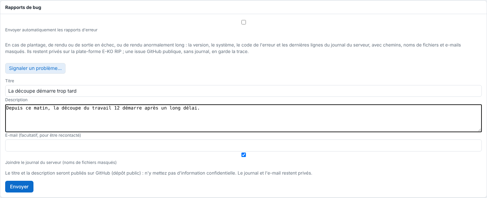

The server can send a report by itself when it crashes, when a render or an output fails, or when a render takes unusually long. Nothing is sent without your consent.

## Before you start

You need an administrator account. The first time you open the administration, the server asks whether it may send these reports: you can change your mind afterwards.

## Steps

1. In the client, open **Administration…** (*Administration…*), then the **System** (*Système*) view.
2. Scroll down to the **Bug reports** (*Rapports de bug*) section.
3. Tick or untick **Send error reports automatically** (*Envoyer automatiquement les rapports d'erreur*).

   
4. As long as nobody has answered yes, nothing is sent.

## Good to know

- What triggers a report (the same code at most once every 6 hours):

  | Kind | Code | When |
  |---|---|---|
  | `plantage` (crash) | `panique` | the server stops on an internal error (written before stopping, sent at restart) |
  | `erreur` (error) | `rendu_echoue`, `decoupe_illisible` | a job's render fails |
  | `erreur` (error) | `sortie_echouee` | an output to a machine fails (not the printer's alerts nor a machine that is switched off) |
  | `lenteur` (slowness) | `rendu_lent` | a render of more than 30 minutes (`EKO_RIP_LENTEUR_MIN`) |
- The content: version, system, code, error detail and the last 300 lines of the server log (`journalctl -u eko-rip-serveur`, which the service is allowed to read). Paths, file names, text in quotation marks (job or customer names) and e-mail addresses are **replaced** before sending.
- They stay private on the E-KO RIP platform. A public issue in the project tracker, without a log, keeps a trace of it: it carries only the title, description, kind of computer, system and reference. Automatic reports with the same signature (computer, kind, code) share one issue, completed by a counter comment at most once a day.
- While the platform is unreachable, reports wait in `rapports/attente/` of the data folder.
- To report a problem yourself, see [Report a problem to the team](../rip-depannage/rip-signaler-un-probleme.md).
- On the platform side, a report is kept for 90 days; it is limited to 20 reports per installation and 500 in total per day.

## See also

- [Report a problem to the team](../rip-depannage/rip-signaler-un-probleme.md)
- [Understand the anonymous statistics](rip-comprendre-les-statistiques-anonymes.md)
- [Monitor the server service](rip-surveiller-le-service-du-serveur.md)
