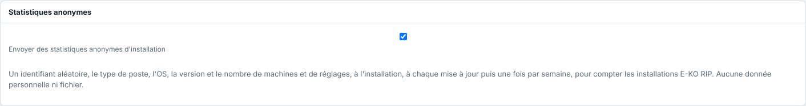

To know how many E-KO RIPs are running (servers, Mac, Linux and Windows workstations, phones), each installation sends a small message to the E-KO RIP platform: at installation, at each update, then once a week. It is sent whether or not the server is linked to the Cloud.

## Before you start

To turn off sending on the server, you need an administrator account. For the clients, you need access to the computer concerned.

## Steps

1. Read what is sent:

   | Field | Example | Note |
   |---|---|---|
   | `id` | `3f9c…` (32 characters) | drawn at random on the computer, once; says nothing about the computer |
   | `type` | `serveur`, `client-mac`, `client-linux`, `client-windows`, `client-mobile` | |
   | `evenement` | `installation`, `mise_a_jour`, `hebdo` | install, update, weekly |
   | `version` | `0.30.0` | software version |
   | `os` | `Ubuntu 26.04 LTS`, `macOS 26.1.0` | name and version of the system, nothing else |
   | `machines`, `reglages` | `3`, `5` | server only: number of machines and of presets |
2. To stop sending from the server: in the client, open **Administration…** (*Administration…*), **System** (*Système*) view, **Anonymous statistics** (*Statistiques anonymes*) section, then untick **Send anonymous installation statistics** (*Envoyer des statistiques anonymes d'installation*).

   
3. On a Mac, untick the sending in **System › Privacy** (*Système › Confidentialité*); on a Linux computer, in **System › This computer** (*Système › Ce poste*).
4. To stop everything at once on a computer, set the environment variable `EKO_TELEMETRIE=0`. On the server, add it to `/etc/default/eko-rip-serveur` then run `sudo systemctl restart eko-rip-serveur`.

## Good to know

- Nothing else is sent: no computer, workshop, machine or user name, no file, no job. The platform does not keep the IP address.
- The expected response is a simple acknowledgement (`204`); on failure, another attempt is made later, with nothing displayed.
- When turned off by `EKO_TELEMETRIE=0`, the checkbox in the **System** view says so: "Désactivé sur ce serveur par EKO_TELEMETRIE=0" (turned off on this server by EKO_TELEMETRIE=0).
- The state is kept in `telemetrie.json` (the server's data folder, the Linux client's configuration folder) or in the Mac's preferences.
- The statistics serve to count installations (active, by type, system and version); no personal data appears in them.

## See also

- [Allow or refuse automatic error reports](rip-autoriser-les-rapports-d-erreur-automatiques.md)
- [Change the server's advanced settings](rip-modifier-les-reglages-avances-du-serveur.md)
- [Connect to the server from a workstation](../rip-premiers-pas/rip-se-connecter-au-serveur.md)
