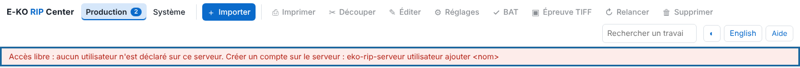
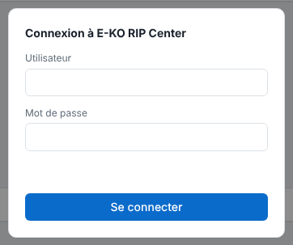
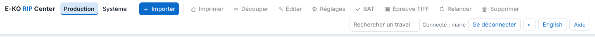

As long as no account exists, any workstation on the network can do everything and the screen flags it in red. This article is for the person who administers the server.

## Before you start

The server is installed (see [Install the RIP server](../rip-premiers-pas/rip-installer-le-serveur.md)). You have a terminal on the server and `sudo` access. Choose passwords of at least 10 characters.

## Steps

1. In the client, open **Administration…** (*Administration…*): as long as no account exists, a red **Open access** (*Accès libre*) banner is shown under the toolbar.

   
2. On the server, create the first account, which will be the administrator:
   `sudo -u eko-rip env EKO_RIP_DATA=/var/lib/eko-rip eko-rip-serveur utilisateur ajouter marie`
3. Enter the password twice. It is not displayed.
4. Create one account per operator:
   `sudo -u eko-rip env EKO_RIP_DATA=/var/lib/eko-rip eko-rip-serveur utilisateur ajouter julie operateur`
5. Reload **Administration…**: the **Connexion à E-KO RIP Center** (*Sign in to E-KO RIP Center*) screen asks for the **User** (*Utilisateur*) and the **Password** (*Mot de passe*).

   
6. Sign in with each account to check the rights: the red banner has gone and the header shows **Connecté : <name>** (*Signed in: <name>*).

   

## Good to know

- **Administrator** (`admin`) can do everything: machines, media and rates, ICC profiles, saved presets, backup, Cloud.
- **Operator** (`operateur`) sends, edits, prints, cuts, and manages the queue and the sheets; they see the machines but cannot set them up.
- With no role given, the account is an administrator if there is none yet, an operator otherwise.
- No restart is needed.
- The Cloud and the mobile app require accounts.

## See also

- [Manage the server accounts](rip-gerer-les-comptes.md)
- [Connect to the server from a workstation](../rip-premiers-pas/rip-se-connecter-au-serveur.md)
- [Connection refused](../rip-depannage/rip-connexion-refusee.md)
- [Change the server's advanced settings](rip-modifier-les-reglages-avances-du-serveur.md)
