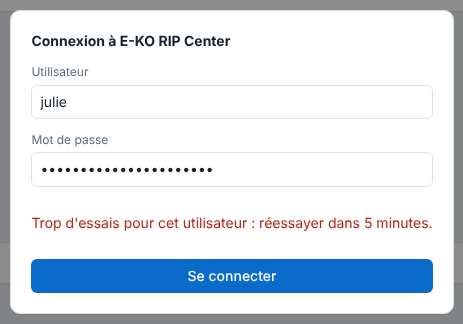

This article covers the day-to-day life of accounts: forgotten password, change of role, a person leaving.

## Before you start

You have a terminal on the server and `sudo` access.

## Steps

1. List the accounts: `sudo -u eko-rip env EKO_RIP_DATA=/var/lib/eko-rip eko-rip-serveur utilisateur liste`
2. For a forgotten password or a change of role, declare the account again: `… utilisateur ajouter <name> operateur` (or `admin`). The new password and role replace the old ones.
3. To delete an account: `… utilisateur supprimer <name>`.
4. Tell the person concerned to sign in again if needed.
5. If they entered five wrong passwords, their name is blocked for 5 minutes: the sign-in screen shows "Trop d'essais pour cet utilisateur : réessayer dans 5 minutes." (too many attempts for this user: try again in 5 minutes). Ask them to wait.

   

## Good to know

- In these commands, `…` stands for the start `sudo -u eko-rip env EKO_RIP_DATA=/var/lib/eko-rip eko-rip-serveur`.
- Deleting an account closes its sessions immediately.
- Five wrong passwords block the name for 5 minutes ("Trop d'essais pour cet utilisateur : réessayer dans 5 minutes.").
- No restart is needed.
- No administrator left: an account declared with no role becomes one.
- Passwords are stored hashed (Argon2id) in `utilisateurs.json` (permissions 0600), never in clear text.
- A session lasts 12 hours and is lost when the server restarts.

## See also

- [Create the server accounts](rip-creer-les-comptes.md)
- [Connection refused](../rip-depannage/rip-connexion-refusee.md)
- [Back up the server configuration](rip-sauvegarder-la-configuration.md)
- [Monitor the server service](rip-surveiller-le-service-du-serveur.md)
