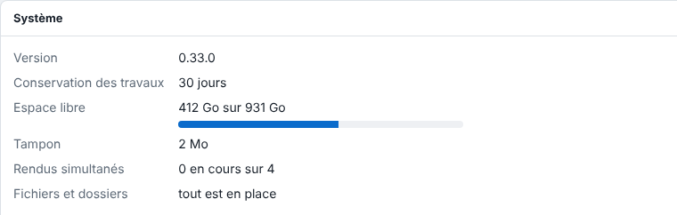

Server updates are done along with those of the system. This article is for the administrator.

## Before you start

The server was installed from the E-KO package repository. Warn the operators: restarting the service interrupts the render in progress.

## Steps

1. On the server, open a terminal.
2. If possible, first download the configuration backup (see [Back up the configuration](rip-sauvegarder-la-configuration.md)).
3. Run: `sudo apt update && sudo apt upgrade`.
4. Check the version: in **Administration…** (*Administration…*), open the **System** (*Système*) view and read the **Version** (*Version*) line.

   
5. Retry the jobs that ended in "interrompu" (interrupted) failure with **Retry** (*Relancer*).

## Good to know

- The data stays in place. Before each update, the package copies the configuration by itself into `/var/lib/eko-rip/sauvegardes/`.
- The administration interface comes from the server: new features appear there as soon as it is updated.
- The clients are updated separately (see [Install the client on Linux](../rip-premiers-pas/rip-installer-le-client-linux.md)). A client slightly older than the server keeps working.
- What is new in each version is in the release notes: https://e-ko.rip/changelog/.
- Installed by hand with a `.deb` file, the server is updated the same way, by hand.

## See also

- [Back up the server configuration](rip-sauvegarder-la-configuration.md)
- [Rebuild a server from a backup](rip-remonter-un-serveur.md)
- [Install the RIP server](../rip-premiers-pas/rip-installer-le-serveur.md)
- [Install the server without the repository (package, Docker, binary)](../rip-premiers-pas/rip-installer-le-serveur-sans-depot.md)
