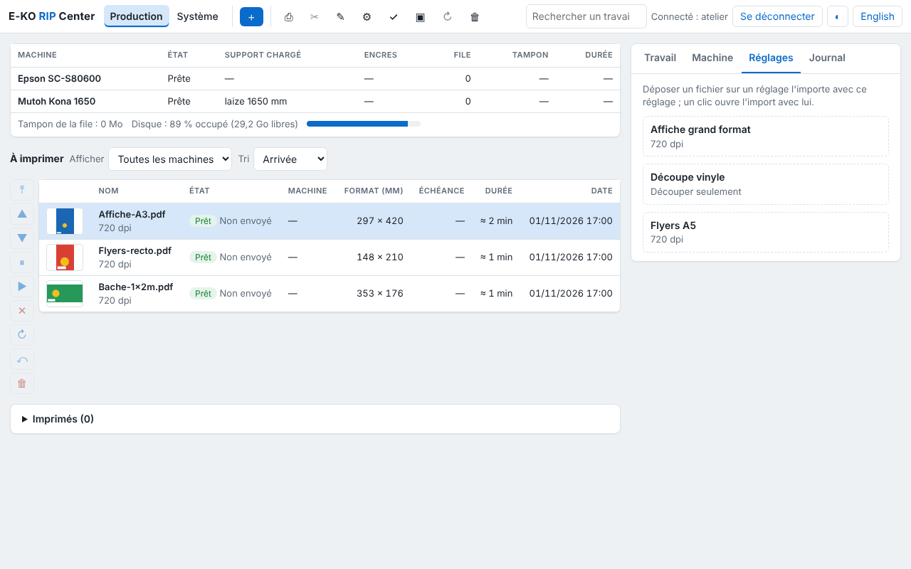

Each saved preset has a folder on the server. By sharing it, workstations drop files into it that go to the RIP with that preset.

## Before you start

You have a terminal on the server and `sudo` access. Each folder is located under `/var/lib/eko-rip/entrees/<preset>/`.

## Steps

1. Install Samba: `sudo apt install samba`.
2. Add to the end of `/etc/samba/smb.conf`:
   `[eko-rip]`, then `path = /var/lib/eko-rip/entrees`, `writable = yes`, `force user = eko-rip` and `valid users = eko`, one line each.
3. Create the share password: `sudo smbpasswd -a eko`.
4. Restart the share: `sudo systemctl restart smbd`.
5. On Mac or Linux, open `smb://<server-address>/eko-rip`. On Windows, open `\\<server-address>\eko-rip`.
6. Drop a file into a preset's folder and check that a job appears in the client.

## Good to know

- Hot folders do not need a RIP account: access is controlled by the share.
- A rejected file is moved to `refuses/` with the reason in a `.refus.txt` file.
- The name `eko` in the example is the share account's name: choose your own.

## See also

- [Drop a file into a hot folder](../rip-travaux/rip-deposer-un-fichier-dans-un-dossier-surveille.md)
- [Back up the server configuration](rip-sauvegarder-la-configuration.md)
- [Manage the server accounts](rip-gerer-les-comptes.md)
- [Know the server's network ports](../rip-premiers-pas/rip-connaitre-les-ports-reseau-du-serveur.md)
