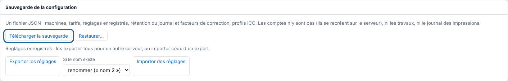

The configuration backup contains the machines, media, rates, saved presets, cutting, spot colours and ICC profiles.

## Before you start

You need an administrator account. Plan a place away from the server to keep the file.

## Steps

1. In the client, open **Administration…** (*Administration…*).
2. Open the **System** (*Système*) view, then scroll down to the **Configuration backup** (*Sauvegarde de la configuration*) section.
3. Click **Download the backup** (*Télécharger la sauvegarde*).

   
4. Copy the file to another computer or an external disk.
5. Make the backup again after every settings change.

## Good to know

- Before each update, the package copies the configuration by itself into `/var/lib/eko-rip/sauvegardes/`; the last 10 are kept.
- To back up everything, accounts included, copy the `/var/lib/eko-rip` folder with the service stopped. Jobs are large and can be redone from their source files: the configuration and the accounts file (`utilisateurs.json`) are often enough.
- **Export the presets** (*Exporter les réglages*) downloads only the saved presets, to take them up on another server with **Import presets** (*Importer des réglages*).

- The downloaded file is in JSON format: machine catalogue, rates, saved presets, cutting, spot colours and uploaded ICC profiles. Accounts are not in it (recreate them on the server), nor are the jobs or the queue.
- **Restore…** replaces machines, rates and presets with those of the file and adds its profiles. For a new server: install, create the administrator account, restore.

## See also

- [Rebuild a server from a backup](rip-remonter-un-serveur.md)
- [Update the server](rip-mettre-a-jour-le-serveur.md)
- [Manage the server accounts](rip-gerer-les-comptes.md)
- [Find where the server's data is](rip-savoir-ou-sont-les-donnees-du-serveur.md)
