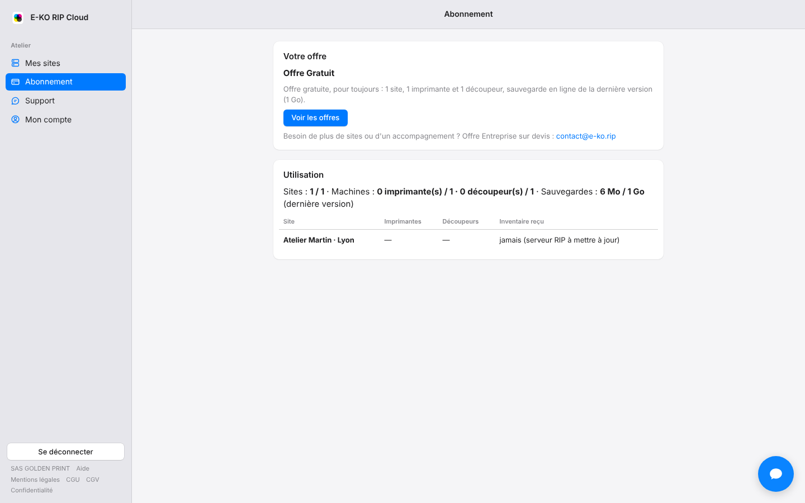
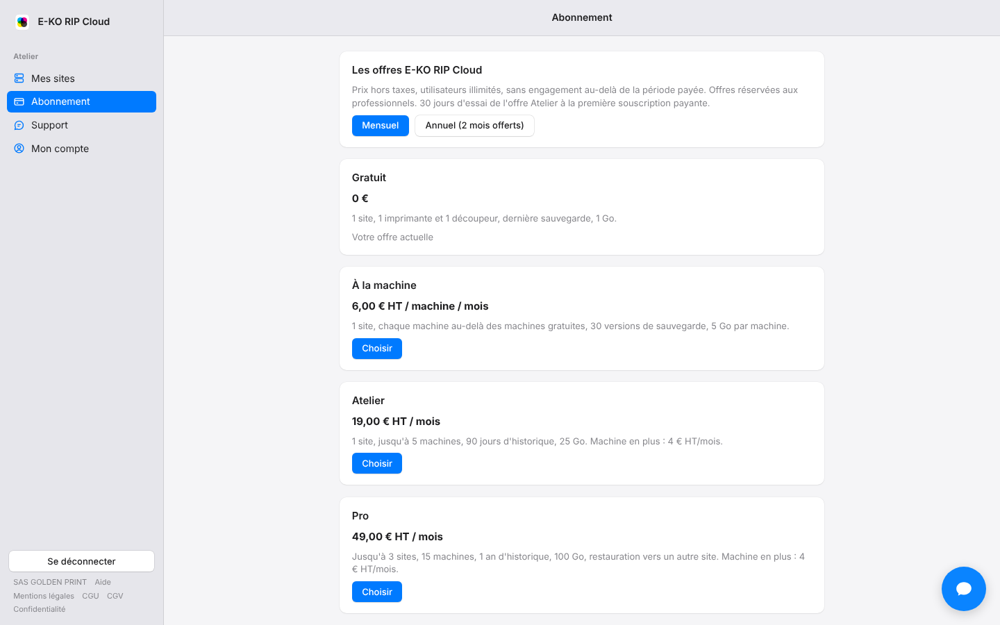

The cloud is free for a small workshop. Paid plans cover larger workshops.
Prices exclude VAT, and the number of users is unlimited.

## Before you start

- Count your sites and machines. The machines counted are those your server declares itself: there is nothing to enter.
- Paid plans are for businesses.

## Steps

1. Find your case in the table below.
2. Open **Subscription** (*Abonnement*) on the portal: the **Usage** section (*Utilisation*) counts your sites, machines and backups.

   
3. Click **See the plans** (*Voir les offres*), choose **Monthly** (*Mensuel*) or **Annual (2 months free)** (*Annuel (2 mois offerts)*), then **Choose** (*Choisir*) on the plan you want.

   

| Plan | Price (excl. VAT) | Sites | Machines | Online backups | Storage |
|---|---|---|---|---|---|
| Free | €0, no time limit | 1 | 1 printer + 1 cutter | latest version | 1 GB |
| Per machine | €6 / month per machine beyond the free ones | 1 | as needed | 30 versions | 5 GB per machine |
| Atelier | €19 / month | 1 | up to 5 (+€4 / month per extra machine) | 90 days | 25 GB |
| Pro | €49 / month | 3 | up to 15 (+€4 / month per extra machine) | 1 year, restore to another site | 100 GB |
| Enterprise | on quote | | | | |

## Good to know

- **Annual subscription**: 10 months paid for 12 months of service.
- **Trial**: if your first paid subscription is the Atelier plan, you get a 30-day trial, with no invoice before it ends. A card is only checked, not charged. The trial is offered once per account.
- **Enterprise**: for larger needs, write to contact@e-ko.rip.
- Count your machines with [Understand the machines counted in your plan](rip-cloud-comprendre-les-machines-comptees.md).
- Full terms are in the [terms of sale](https://platform.e-ko.rip/cgv) (in French).

## See also

- [Subscribe to a plan](rip-cloud-souscrire-une-offre.md)
- [Make the most of the Atelier plan's 30-day trial](rip-cloud-essai-atelier.md)
- [When your fleet exceeds the plan](rip-cloud-parc-depasse-l-offre.md)
