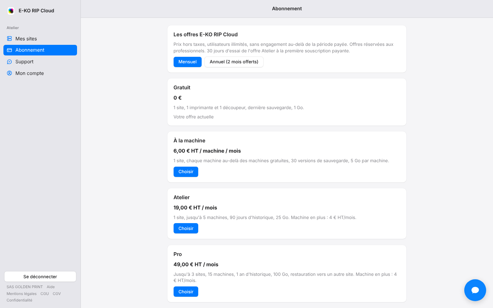
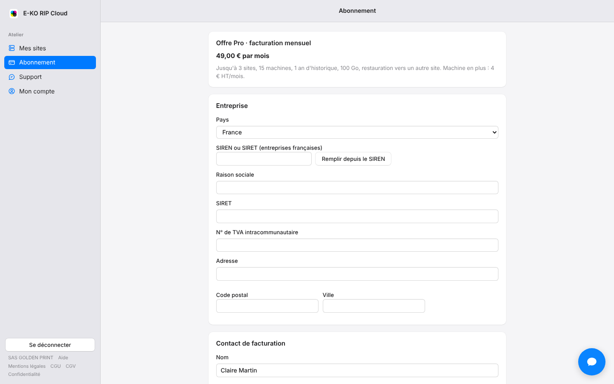

You subscribe to a paid plan directly in the portal.
Allow a few minutes.

## Before you start

- Choose the plan and the billing period (monthly or annual). See [Choose a plan](rip-cloud-choisir-une-offre.md).
- Prepare the SIREN or SIRET number, the billing e-mail and a mobile phone (it receives the SEPA mandate code).
- For SEPA direct debit, have the IBAN at hand.
- Paid plans are for businesses.

## Steps

1. Open **Subscription** (*Abonnement*), then **See the plans** (*Voir les offres*).
2. Choose **Monthly** (*Mensuel*) or **Annual (2 months free)** (*Annuel (2 mois offerts)*), then click **Choose** (*Choisir*) under the plan you want.

   
3. In the **Company** section (*Entreprise*), enter the SIREN or SIRET and click **Fill in from the SIREN** (*Remplir depuis le SIREN*): the company name and address fill in. Otherwise, enter them by hand. Also enter the intra-Community VAT number if needed.

   
4. In **Billing contact** (*Contact de facturation*), enter the name, the billing e-mail address and the phone number. Choose the country first (flag and dialling code), then type the number as you usually would, for example 06 12 34 56 78. If needed, add a purchase order number.
5. Enter a code in **Promo or partner code** (*Code promo ou partenaire*) if you have one. See [Use a promo or partner code](rip-cloud-utiliser-un-code-promo.md).
6. In **Payment method** (*Moyen de paiement*), choose **Bank card** (*Carte bancaire*) or **SEPA direct debit** (*Prélèvement SEPA*).
7. Tick the acceptance of the terms of sale, then click **Continue to payment** (*Continuer vers le paiement*).
8. Pay without leaving the page. See [Pay by bank card](rip-cloud-payer-par-carte.md) or [Pay by SEPA direct debit](rip-cloud-payer-par-sepa.md).

## Good to know

- An e-mail confirms the subscription, then each invoice. Invoices are issued by **GOLDEN PRINT**; all e-mails come from **E-KO RIP**, to the billing contact, at the start of each period.
- The 30-day trial applies only to the first paid subscription, if it is the Atelier plan. See [Make the most of the Atelier plan's 30-day trial](rip-cloud-essai-atelier.md).
- The Per machine plan and extra machines are billed according to the machines your server declares. See [Understand the machines counted in your plan](rip-cloud-comprendre-les-machines-comptees.md).
- If card payment is unavailable, the page says so: choose SEPA direct debit.

## See also

- [Choose a plan](rip-cloud-choisir-une-offre.md)
- [Find your invoices](rip-cloud-retrouver-ses-factures.md)
- [Change or cancel your plan](rip-cloud-changer-ou-resilier.md)
