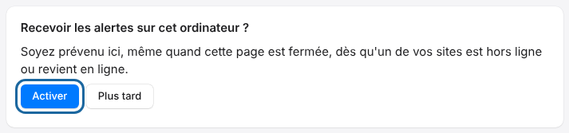
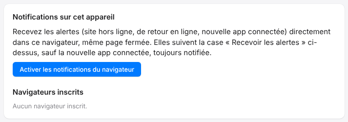

Notifications warn you when a site goes offline, comes back online, or when an app connects.
They follow the **Receive alerts** (*Recevoir les alertes*) box.

## Before you start

- You need a platform account.
- The browser must stay running to receive notifications, even with the page closed.

## Steps

In the browser:

1. Open **My sites** (*Mes sites*): the question **Receive alerts on this computer?** (*Recevoir les alertes sur cet ordinateur ?*) appears after your first sign-in.
2. Click **Enable** (*Activer*).
3. Allow notifications when the browser asks.

   

If you chose **Later** (*Plus tard*):

1. Open **My account** (*Mon compte*).
2. In **Notifications on this device** (*Notifications sur cet appareil*), click **Enable browser notifications** (*Activer les notifications du navigateur*).

   

## Good to know

- The banner **Receive alerts on this computer?** only appears if the browser supports notifications and the choice has not been made. Once you have clicked **Enable** or **Later**, it does not come back: use **My account** instead.
- To stop on one browser, see [Stop notifications on a browser](rip-cloud-retirer-un-navigateur.md).
- If the browser shows "Les notifications sont bloquées pour ce site" (notifications are blocked for this site), allow them in its settings, then reload the page.
- If the browser does not support notifications, the card shows "Ce navigateur ne gère pas les notifications." (this browser does not support notifications).
- At most ten browsers can be registered per account.
- The Mac, Linux and mobile apps ask for permission right after the first sign-in to the cloud. If you refused it, restore it in the system or phone settings.

## See also

- [Understand cloud notifications](rip-cloud-comprendre-les-notifications.md)
- [Choose which e-mails you receive](rip-cloud-choisir-les-emails.md)
- [Connect an app to the cloud](../rip-cloud-premiers-pas/rip-cloud-connecter-une-app.md)
