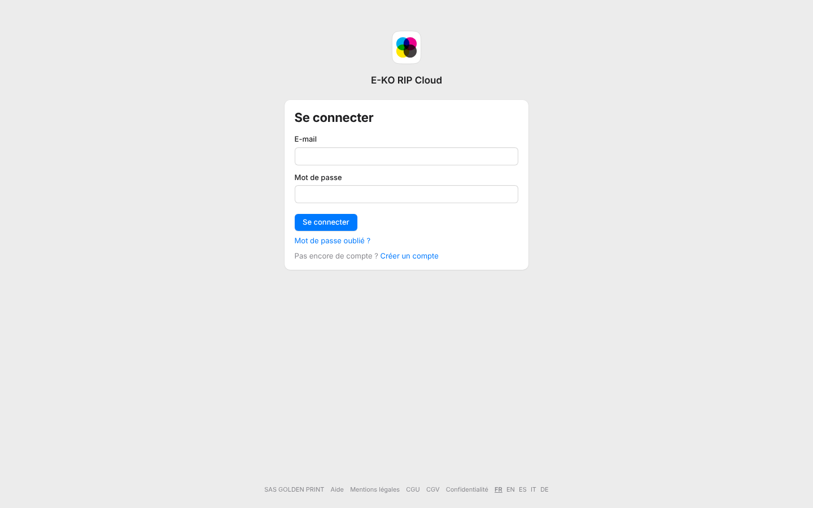
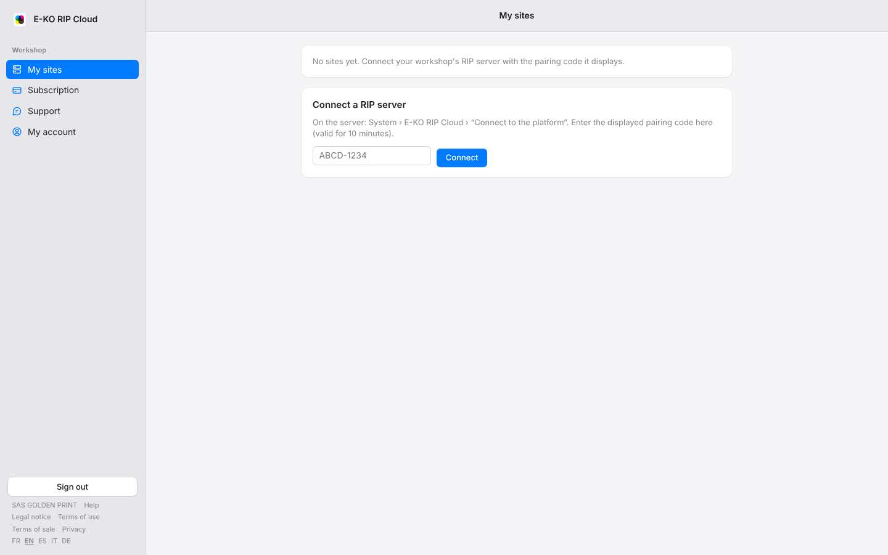

The cloud portal is available in five languages: French, English, Spanish, Italian and German.
The chosen language applies to the pages and, once you are signed in, to the platform's e-mails.

## Before you start

- You do not need an account to change the language of the public pages (home, sign-in, plans).
- On your first visit, the portal follows your browser's language; if that language is not offered, it is shown in English.

## Steps

1. Scroll to the bottom of any portal page. On a computer, once you are signed in, the links are at the bottom of the sidebar.
2. Click the code of the language you want: **FR**, **EN**, **ES**, **IT** or **DE**.

   

3. The page reloads in the chosen language; its code is shown in bold and underlined.

   

## Good to know

- The choice is remembered by this browser for a year. On another computer or browser, make it once more.
- E-mails follow the last language chosen while signed in. An account created in a language other than French receives its e-mails in that language from sign-up.
- The terms and conditions, the legal notice and the privacy policy stay in French, the only binding version: a sentence at the top of these pages says so.
- The support chat bubble is shown in the same language as the portal.
- The names of your sites and machines, and the messages exchanged with support, are never translated.

## See also

- [View and manage your account](rip-cloud-gerer-son-compte.md)
- [Choose which platform e-mails you receive](rip-cloud-choisir-les-emails.md)
- [View the list of platform e-mails](rip-cloud-comprendre-les-emails.md)
