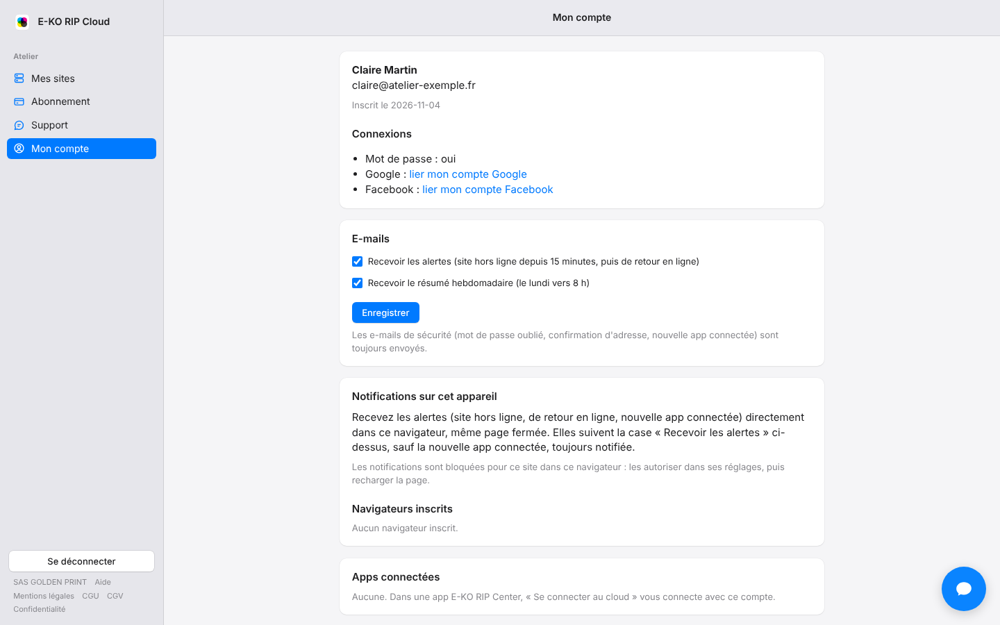

The platform writes to you when a site is offline and sends you a summary every week.
You choose what you receive.

## Before you start

- Alerts go to the site's owners and administrators.
- There is nothing to set up on the mail side. Messages come from **E-KO RIP Cloud**. Do not reply to them.

## Steps

1. Open **My account** (*Mon compte*) on the portal.
2. Tick or untick **Receive alerts** (*Recevoir les alertes*).
3. Tick or untick **Receive the weekly summary** (*Recevoir le résumé hebdomadaire*).
4. Click **Save** (*Enregistrer*).

   

## Good to know

- Both boxes are ticked by default.
- An "offline" alert is sent when the server has been unreachable for 15 minutes, at most once per hour per site. A "back online" e-mail follows.
- The summary arrives every Monday around 8 a.m.: outages, time offline, longest outage, alerts and connected apps.
- The "new app connected" e-mail is always sent: it is a security measure, like the forgotten-password and address-confirmation e-mails.
- The boxes do not control billing e-mails, backup alerts or support replies.
- Alerts also follow browser and app notifications: see [Understand cloud notifications](rip-cloud-comprendre-les-notifications.md).

## See also

- [View the list of platform e-mails](rip-cloud-comprendre-les-emails.md)
- [Enable notifications](rip-cloud-activer-les-notifications.md)
- [The site is offline](../rip-cloud-depannage/rip-cloud-site-hors-ligne.md)
