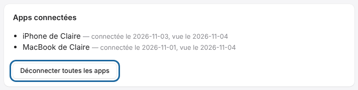

You can cut off access for every app linked to your account in one go.
This is useful after losing a device.

## Before you start

- Sign in to the portal with your account.

## Steps

1. Open <https://platform.e-ko.rip> and sign in.
2. Open **My account** (*Mon compte*).
3. In **Connected apps** (*Apps connectées*), click **Disconnect all apps** (*Déconnecter toutes les apps*).

   

## Good to know

- For a single app, use **Sign out of the cloud** (*Se déconnecter du cloud*) in the app: this removes that device's access.
- Changing your password also closes all sessions and disconnects the apps.
- The list shows, for each device, the sign-in date and the last use. An app's access lasts about 180 days.
- The apps must then sign in again with **Sign in to the cloud** (*Se connecter au cloud*).

## See also

- [Connect an app to the cloud](../rip-cloud-premiers-pas/rip-cloud-connecter-une-app.md)
- [Forgotten password](rip-cloud-mot-de-passe-oublie.md)
- [Understand cloud security](../rip-cloud-premiers-pas/rip-cloud-securite.md)
