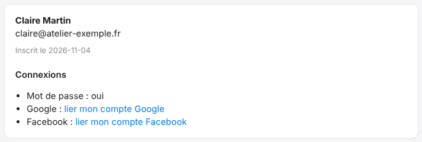
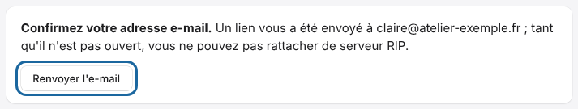

The **My account** (*Mon compte*) page is the dashboard for your platform account.
It gathers all the settings that concern you.

## Before you start

- Sign in to the portal.
- Do not confuse this account with a RIP server account: the latter is managed on the server (see [Manage the server's accounts](../rip-administration/rip-gerer-les-comptes.md)).

## Steps

1. Open **My account** in the left-hand menu.
2. In the first card, read your name, your e-mail address and the sign-up date. Under **Sign-ins** (*Connexions*), check how you sign in: **Password** (*Mot de passe*), **Google**, **Facebook**.

   
3. To add a sign-in method, click **link my Google account** (*lier mon compte Google*) or **link my Facebook account** (*lier mon compte Facebook*), then follow the provider's screens.
4. In the **E-mails** card, set the alerts and the summary. See [Choose which e-mails you receive](rip-cloud-choisir-les-emails.md).
5. In the **Notifications on this device** card (*Notifications sur cet appareil*), enable browser notifications. See [Enable cloud notifications](rip-cloud-activer-les-notifications.md).
6. In **Connected apps** (*Apps connectées*), find the devices linked to your account. See [Disconnect apps from the cloud](rip-cloud-deconnecter-les-apps.md).
7. At the bottom of the page, the **Delete my account** section (*Supprimer mon compte*) erases the account. See [Delete your account](rip-cloud-supprimer-son-compte.md).

## Good to know

- If the page offers **Google** or **Facebook** at sign-up, the same buttons let you sign in without a password.
- An e-mail address that is already registered is linked to Google only if Google has verified the address. It is never linked to Facebook without a prior sign-in: linking is done here, from **My account**.
- An unconfirmed e-mail address is flagged by a banner at the top of the page.

  
- To change your password, use [Forgotten password](rip-cloud-mot-de-passe-oublie.md): the new password closes all sessions.
- A site's owner is the account that linked it. See [Understand roles on a site](rip-cloud-roles-sur-un-site.md).

## See also

- [Discover the E-KO RIP Cloud portal](../rip-cloud-premiers-pas/rip-cloud-decouvrir-le-portail.md)
- [Choose which e-mails you receive](rip-cloud-choisir-les-emails.md)
- [Delete your account](rip-cloud-supprimer-son-compte.md)
