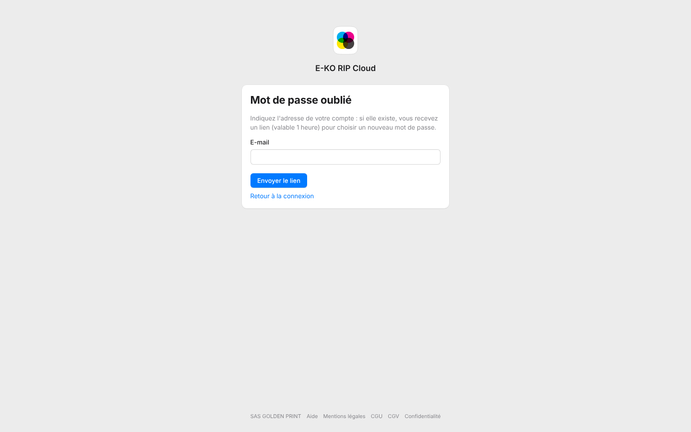

If you have forgotten your platform account's password, a link lets you choose a new one.

## Before you start

- You need access to the account's mailbox.
- The link is valid for 1 hour and works only once.

## Steps

1. On the sign-in page, click **Forgot your password?** (*Mot de passe oublié ?*).
2. Enter the account's address in **E-mail**, then click **Send the link** (*Envoyer le lien*).

   
3. Open the e-mail you receive and click the link within the hour.
4. Choose a new password.

## Good to know

- For security, the page answers the same way whether the address exists or not.
- The new password closes all the account's sessions and disconnects its apps.
- After 5 failed sign-ins, the password is blocked for 5 minutes.
- A RIP server account's password is managed on the server, not on the platform. See [Manage the server's accounts](../rip-administration/rip-gerer-les-comptes.md).
- You can request at most 3 e-mails per hour per address. No e-mail is sent for a suspended account.
- If the link is no longer valid, request a new one: see [Fix an expired or invalid link](../rip-cloud-depannage/rip-cloud-lien-expire.md).
- If the password is blocked, see [Fix a blocked password](../rip-cloud-depannage/rip-cloud-mot-de-passe-bloque.md).

## See also

- [Disconnect apps from the cloud](rip-cloud-deconnecter-les-apps.md)
- [I am not receiving the e-mails](../rip-cloud-depannage/rip-cloud-emails-non-recus.md)
