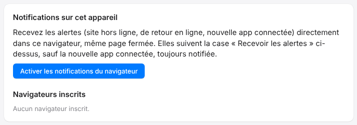

If you no longer want alerts on a computer, remove its browser from the list.
Your other devices are not affected.

## Before you start

- Sign in to the portal from any device.
- You can register up to ten browsers per account: removing those you no longer use frees up slots.

## Steps

1. Open **My account** (*Mon compte*).
2. Find the **Notifications on this device** card (*Notifications sur cet appareil*), then the **Registered browsers** list (*Navigateurs inscrits*).
3. Click **Remove** (*Retirer*) next to the browser to stop.

   

## Good to know

- Removing a browser does not erase the browser's permission; to turn that off too, use the browser's settings.
- To stop receiving any alert at all, also untick **Receive alerts** (*Recevoir les alertes*). See [Choose which e-mails you receive](rip-cloud-choisir-les-emails.md).
- To turn it back on later, click **Enable browser notifications** (*Activer les notifications du navigateur*): see [Enable cloud notifications](rip-cloud-activer-les-notifications.md).
- The **new app connected** notification is always sent, for security.

## See also

- [Understand cloud notifications](rip-cloud-comprendre-les-notifications.md)
- [Enable cloud notifications](rip-cloud-activer-les-notifications.md)
- [View and manage your account](rip-cloud-gerer-son-compte.md)
