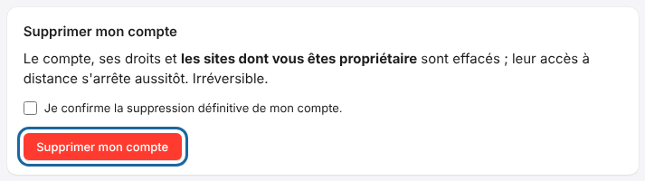

Deleting your account ends all access to the cloud.
The workshop's RIP server stays usable on site.

## Before you start

- Deletion erases the account, its rights and **the sites it owns**. Their remote access stops immediately.
- If you have a paid subscription, remember to cancel it first.

## Steps

1. Open **My account** (*Mon compte*).
2. Go to the **Delete my account** section (*Supprimer mon compte*).
3. Tick **I confirm the permanent deletion of my account.** (*Je confirme la suppression définitive de mon compte.*)
4. Click **Delete my account**.

   

## Good to know

- To keep the account and cut off just one site, see how to unlink a server.
- Deletion cannot be undone.
- You can create a new account and link the server again with a new code.

## See also

- [Unlink a RIP server from the cloud](rip-cloud-detacher-un-serveur.md)
- [Change or cancel your plan](../rip-cloud-abonnement/rip-cloud-changer-ou-resilier.md)
