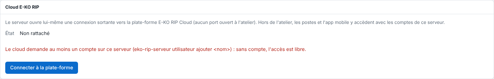

The server shows "Le cloud demande au moins un compte sur ce serveur" (the cloud requires at least one account on this server) when you try to link it.
This is a safeguard: without an account, access to the server is open on the local network.

## Before you start

- You are in the workshop, signed in to the server as an administrator.
- The message appears in **System › E-KO RIP Cloud** (*Système › Cloud E-KO RIP*).

  

## Steps

1. Create a user account on the server. See [Create the server's accounts](../rip-administration/rip-creer-les-comptes.md).
2. Go back to **System › E-KO RIP Cloud**: the message disappears.
3. Click **Connect to the platform** (*Connecter à la plate-forme*) to get a code.
4. Continue linking. See [Link a RIP server to the cloud](../rip-cloud-premiers-pas/rip-cloud-relier-un-serveur.md).

## Good to know

- On the server, the command `sudo eko-rip-serveur utilisateur ajouter <name>` also creates an account.
- As a precaution, the server also refuses any request coming through the cloud while no account exists (code `cloud_sans_compte`).
- Once the server is linked, the accounts used remotely are those of the RIP server.

## See also

- [Create the server's accounts](../rip-administration/rip-creer-les-comptes.md)
- [Link a RIP server to the cloud](../rip-cloud-premiers-pas/rip-cloud-relier-un-serveur.md)
- [Fix an expired or refused linking code](rip-cloud-code-expire.md)
