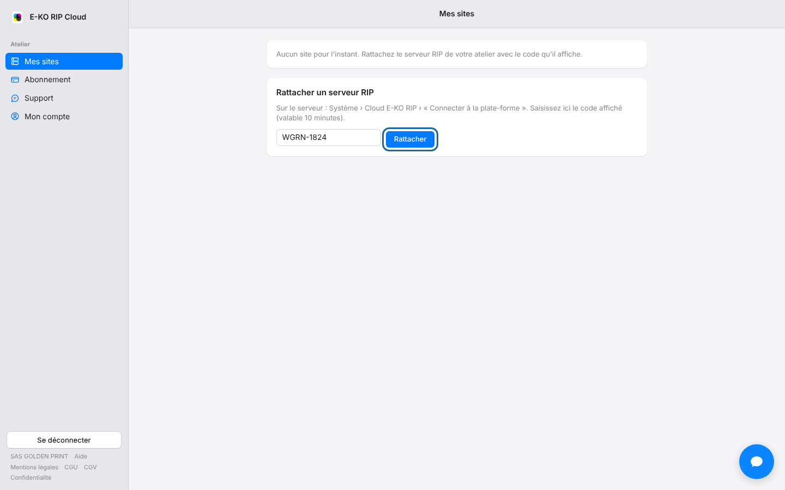

The linking code is valid for only 10 minutes.
A new code fixes most refusals.

## Before you start

- You are in the workshop, signed in to the RIP server as an administrator.
- Your platform account's e-mail address must be confirmed.

## Steps

1. Open **System › E-KO RIP Cloud** (*Système › Cloud E-KO RIP*) on the server.
2. Click **Connect to the platform** (*Connecter à la plate-forme*) again to get a new code.
3. Enter it in **My sites** (*Mes sites*) then click **Link** (*Rattacher*).

## Good to know

- If the portal still refuses, confirm your e-mail address.
- The code looks like `KXRT-4821` and can be entered only once. If the portal refuses a valid code, check that no character is missing.
- If the cloud will not open because of the "au moins un compte" (at least one account) message, first create an account on the RIP server, then try again.

## See also

- [Link a RIP server to the cloud](../rip-cloud-premiers-pas/rip-cloud-relier-un-serveur.md)
- [Confirm your e-mail address](../rip-cloud-premiers-pas/rip-cloud-confirmer-adresse-email.md)
