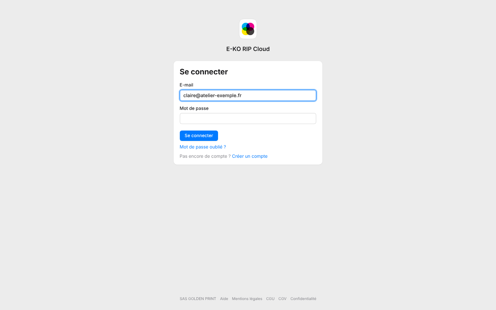

After 5 wrong passwords in a row, the account is blocked for 5 minutes.
This protects against repeated guessing.

## Before you start

- Do not keep trying: each failure extends the wait.
- If you no longer remember the password, go straight to the reset.

## Steps

1. Wait 5 minutes without trying again.
2. Sign in again with the right password.
3. If you have forgotten it, click **Forgot your password?** (*Mot de passe oublié ?*) on the sign-in page. See [Reset a forgotten password](../rip-cloud-compte/rip-cloud-mot-de-passe-oublie.md).

   

## Good to know

- This lockout concerns the platform account. RIP server accounts have their own protection: see [Sign in to the server from a workstation](../rip-premiers-pas/rip-se-connecter-au-serveur.md).
- Per-address limits also apply to sign-ups and sign-ins.
- A suspended account can no longer sign in: contact support.
- If you sign in with Google or Facebook, no platform password is asked for.

## See also

- [Reset a forgotten password](../rip-cloud-compte/rip-cloud-mot-de-passe-oublie.md)
- [Fix an expired or invalid link](rip-cloud-lien-expire.md)
- [Contact live support](rip-cloud-joindre-le-support.md)
