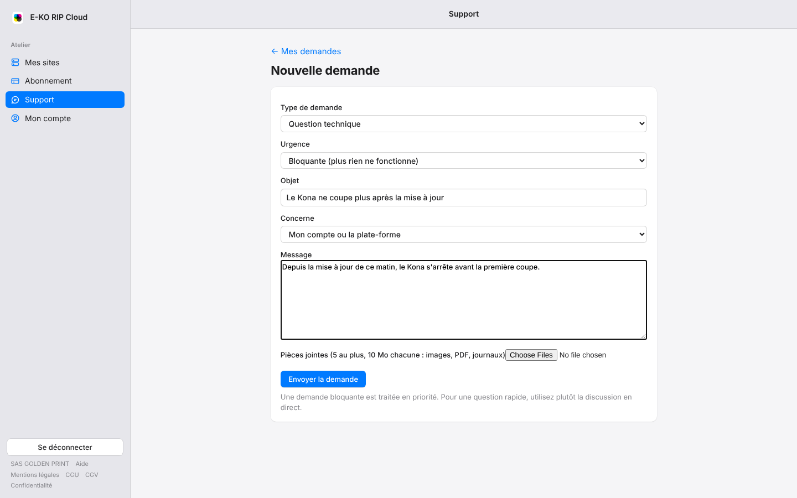
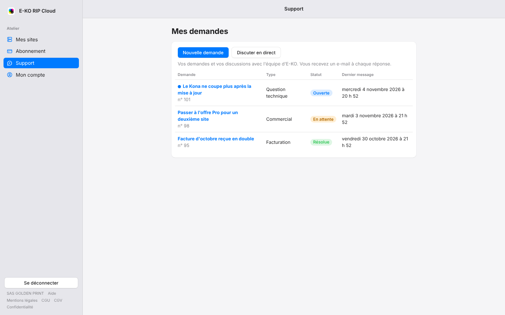
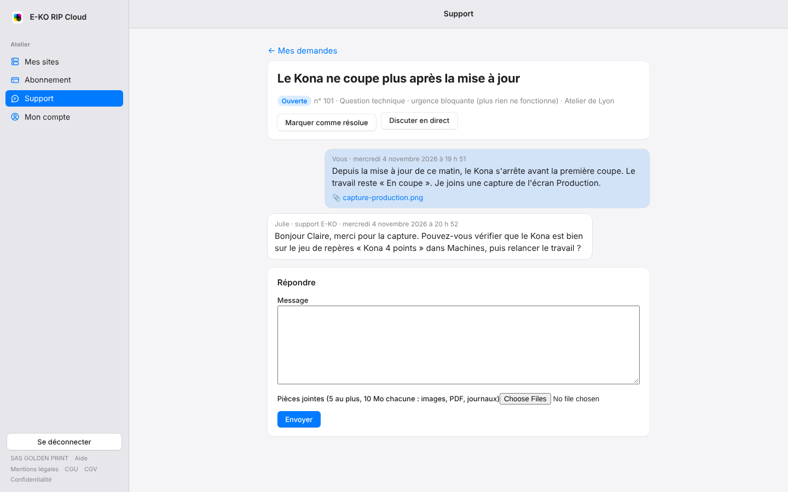

The portal's **Support** page gathers your written requests to the E-KO team. A request
keeps the whole history of a topic: your messages, the replies, the attachments and its
status. For a quick question, live chat is still simpler.

## Before you start

- Sign in to the portal with your account.
- Prepare what helps the team understand: a screenshot, the RIP server log, the name of the
  site and machine concerned.

## Steps

To open a request:

1. Click **Support** in the sidebar, then **New request** (*Nouvelle demande*).
2. Choose the **Request type** (*Type de demande*): Technical question, Billing, Sales or Other.
3. Choose the **Urgency** (*Urgence*):
   - **Normal** (*Normale*) for most questions;
   - **High** (*Haute*) if part of production is hindered;
   - **Blocking** (*Bloquante*) if nothing works any more. These requests are handled first.
4. Write a short **Subject** (*Objet*), for example "The Kona no longer cuts after the update".
5. In **Concerns** (*Concerne*), choose the site in question, your account, your subscription, or **Other**.
6. Describe the problem in **Message**: what you were doing, what is shown, since when.
7. If needed, add **Attachments** (*Pièces jointes*), then click **Send request** (*Envoyer la demande*).

The request opens immediately: its number is shown next to the status. Quote it if you
write to the team about it.

## View your requests

1. Click **Support** in the sidebar. The **My requests** page (*Mes demandes*) opens.
2. Each line shows the request's subject, its number, its type, its status and the date of the
   last message.
3. A blue dot in front of the subject flags a reply you have not read yet.

The possible statuses:

| Status | What it means |
|---|---|
| Open (*Ouverte*) | The team is handling the request. |
| Waiting (*En attente*) | The team is waiting for a reply or information from you. |
| Resolved (*Résolue*) | The request is closed. A new reply from you reopens it. |

## Read the replies and respond

1. On **My requests**, click the request's subject.
2. The thread shows your messages on the right and the team's on the left, with the first name
   of the person replying. Click an attachment to download it.
3. To reply, write in **Reply** (*Répondre*), add attachments if needed, then click
   **Send** (*Envoyer*).

## Close a request

When the problem is fixed, open the request and click **Mark as resolved** (*Marquer comme résolue*). If the
problem comes back, simply reply in the same request: it goes back to **Open**.

## Good to know

- **Attachments**: at most 5 files per message, 10 MB each. Accepted are images
  (PNG, JPEG, GIF, WebP, HEIC), PDFs, logs (`.log`, `.txt`, `.json`) and `.zip`
  archives.
- **E-mails**: for each team reply, you receive the e-mail "Nouvelle réponse à votre
  demande n° …" (new reply to your request no. …) with a link to the request. The text of the reply is not copied into
  the e-mail: it is read on the portal. Another e-mail warns you when the request becomes
  **Resolved**.
- **Privacy**: you only see your account's requests. The team's internal exchanges never
  appear.
- **Chat live** (*Discuter en direct*) opens the support bubble for a quick question. The bubble's conversations
  also appear in **My requests**.
- If the list shows "Le support est momentanément injoignable" (support is temporarily unreachable), try again a few minutes
  later, or write in the bubble.

## See also

- [Contact live support](rip-cloud-joindre-le-support.md)
- [Find an old support request](rip-cloud-ancienne-demande-de-support.md)
- [I am not receiving the e-mails](rip-cloud-emails-non-recus.md)
