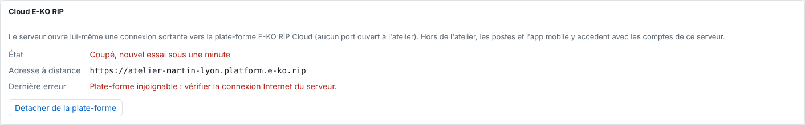

An offline site means the workshop's RIP server is not linked to the platform.
The checks are done on site.

## Before you start

- An "offline" e-mail is sent when the server has been unreachable for 15 minutes.
- You need physical or network access to the workshop's server.

## Steps

1. Check on site that the server is switched on.
2. Check that it has Internet access.
3. Open **System › E-KO RIP Cloud** (*Système › Cloud E-KO RIP*).
4. If the message **Platform unreachable** (*Plate-forme injoignable*) appears, fix the Internet connection.

   
5. Wait a minute: the server reconnects by itself.

## Good to know

- If the alert is enabled, a "back online" e-mail confirms recovery.
- Work in the workshop is not affected by a cloud outage.
- If the site stays offline, contact live support.
- In **System › E-KO RIP Cloud**, a **Disconnected, retrying within a minute** status (*Coupé, nouvel essai sous une minute*) means the server is retrying by itself: it first waits 1 second, then 2, and so on up to 60 seconds.
- You receive the "offline" e-mail at most once per site per hour. See [View the list of platform e-mails](../rip-cloud-compte/rip-cloud-comprendre-les-emails.md).
- If a site appears offline in the mobile app, see [A site appears offline in the mobile app](../rip-depannage/rip-site-hors-ligne-dans-l-application-mobile.md).

## See also

- [Choose which e-mails you receive](../rip-cloud-compte/rip-cloud-choisir-les-emails.md)
- [Contact live support](rip-cloud-joindre-le-support.md)
- [Link a RIP server to the cloud](../rip-cloud-premiers-pas/rip-cloud-relier-un-serveur.md)
