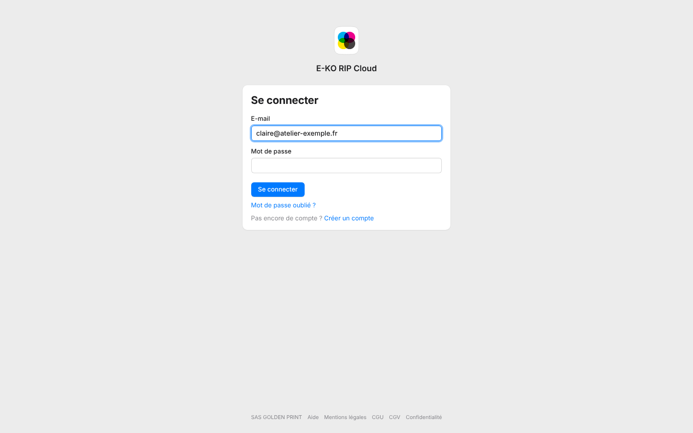
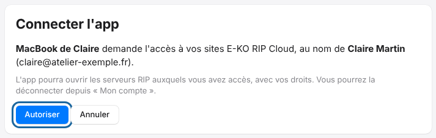

The Mac, Linux and mobile apps connect to the cloud in a few clicks.
You avoid entering an address and a second password.

## Before you start

- You need a platform account and a linked server.
- An app's access stays valid for about 180 days.

## Steps

1. On the app's sign-in screen, click **Sign in to the cloud** (*Se connecter au cloud*). The browser opens on the platform.
2. Sign in with your account (password, Google or Facebook).
3. Authorise the app when the portal asks.
4. Go back to the app: it shows the list of the account's sites, online or not.
5. Choose the site you want.

At step 3, the portal shows **Connect the app** (*Connecter l'app*): click **Authorise** (*Autoriser*), or **Cancel** (*Annuler*) to refuse.

## Good to know

- Rights follow the account's role on the site: an owner or an administrator is a RIP administrator, an operator is an operator, a read-only account cannot change anything.
- Each time a new app is connected, a security e-mail is sent to the account holder.
- **Sign out of the cloud** (*Se déconnecter du cloud*), in the app, removes the device's access.
- The portal only shows the sites for which your account has a role. Rights in the app follow that role, which is set in the portal.
- The apps ask for permission to show notifications right after the first sign-in. See [Enable cloud notifications](../rip-cloud-compte/rip-cloud-activer-les-notifications.md).
- This sign-in replaces entering an address: see also [Sign in to the cloud from the Mac or Linux client](../rip-premiers-pas/rip-se-connecter-au-cloud-depuis-le-client.md).
- Roles are explained in [Understand roles on a site](../rip-cloud-compte/rip-cloud-roles-sur-un-site.md).

## See also

- [Disconnect apps from the cloud](../rip-cloud-compte/rip-cloud-deconnecter-les-apps.md)
- [Access your server remotely](rip-cloud-acceder-a-distance.md)
