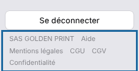

The platform's legal texts are available at any time, signed in or not.

## Before you start

- No account is needed to read them.
- Paid plans are for businesses: the terms of sale apply when you subscribe.
- The legal texts are published in French.

## Steps

1. Open the portal, or stay on any page of the platform.
2. At the bottom of the left-hand menu, find the links **Legal notice** (*Mentions légales*), **Terms of use** (*CGU*), **Terms of sale** (*CGV*) and **Privacy** (*Confidentialité*).

   
3. Click the text you want.

The direct addresses are:

| Text | Address |
|---|---|
| Terms of use | <https://platform.e-ko.rip/cgu> |
| Terms of sale (paid plans) | <https://platform.e-ko.rip/cgv> |
| Privacy policy | <https://platform.e-ko.rip/confidentialite> |
| Legal notice | <https://platform.e-ko.rip/mentions-legales> |

## Good to know

- When you sign up, you accept the terms of use and the privacy policy by ticking the box on the form.
- The terms of sale must be accepted when you subscribe to a paid plan.
- A question? Write to contact@e-ko.rip.
- The **Help** (*Aide*) link, next to these links, opens this help centre.

## See also

- [Create a platform account](rip-cloud-creer-un-compte.md)
- [Subscribe to a paid plan](../rip-cloud-abonnement/rip-cloud-souscrire-une-offre.md)
- [Contact live support](../rip-cloud-depannage/rip-cloud-joindre-le-support.md)
