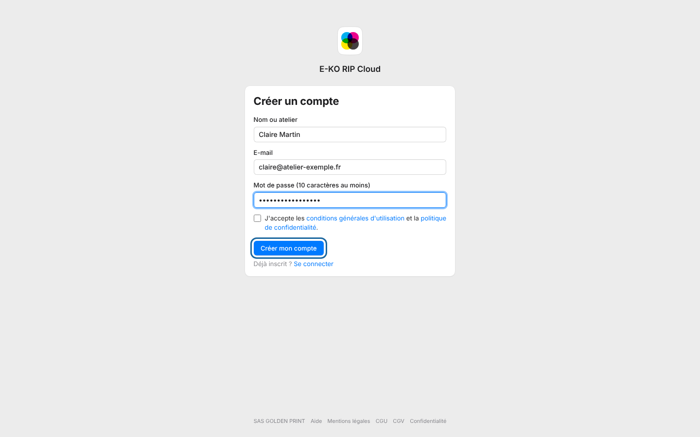

The platform account gives access to the E-KO RIP Cloud portal.
It is for anyone who wants to link their workshop's server.

## Before you start

- Have an e-mail address you check.
- Prepare a password of at least 10 characters.
- Allow two minutes.

## Steps

1. Open <https://platform.e-ko.rip>.
2. Click **Create an account** (*Créer un compte*).
3. Fill in **Name or workshop** (*Nom ou atelier*), **E-mail** and **Password (at least 10 characters)** (*Mot de passe (10 caractères au moins)*).
4. Tick **I accept the terms of use and the privacy policy** (*J'accepte les conditions générales d'utilisation et la politique de confidentialité*).
5. Click **Create my account** (*Créer mon compte*).

   
6. Open the confirmation e-mail you received and click the link it contains.

## Good to know

- If the page offers **Google** or **Facebook**, these buttons let you sign up without a password.
- An account created with Google is confirmed automatically. Otherwise, a confirmation e-mail is sent to you.
- The cloud is optional: the server works in the workshop with or without it.
- An e-mail address that is already registered is linked to Google only if Google has verified the address; it is never linked to Facebook without a prior sign-in (linking is done from **My account**, *Mon compte*).
- To write to the team, see [Contact live support](../rip-cloud-depannage/rip-cloud-joindre-le-support.md).

## See also

- [Confirm your e-mail address](rip-cloud-confirmer-adresse-email.md)
- [Link a RIP server to the cloud](rip-cloud-relier-un-serveur.md)
- [Understand E-KO RIP Cloud](rip-cloud-comprendre-le-cloud.md)
