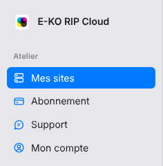

The portal is the platform's website: you manage your sites, your subscription and your account there.
This article presents each page so you can find your way around.

## Before you start

- You need an account. See [Create a platform account](rip-cloud-creer-un-compte.md).
- The portal is at <https://platform.e-ko.rip>.

## Steps

1. Open <https://platform.e-ko.rip> and sign in.
2. Find the menu on the left: it groups the portal's pages.

   
3. Open **My sites** (*Mes sites*) to see your linked servers: name, remote address, status (online or offline), your role and last connection. Here you link a server, remove it (owner only) and open its **Backups** (*Sauvegardes*).
4. Open **Subscription** (*Abonnement*) to see the current plan, the machines counted, the payment method and the invoices (PDF), and to change plan or cancel.
5. Open **Support** to open the live support bubble. See [Contact live support](../rip-cloud-depannage/rip-cloud-joindre-le-support.md).
6. Open **My account** (*Mon compte*) to manage your sign-in methods, e-mails, notifications, connected apps and account deletion. See [View and manage your account](../rip-cloud-compte/rip-cloud-gerer-son-compte.md).
7. At the bottom of the menu, **Sign out** (*Se déconnecter*) ends your session. The links **Legal notice**, **Terms of use**, **Terms of sale** and **Privacy** are there too. See [View the terms and legal notices](rip-cloud-consulter-les-informations-legales.md).

## Good to know

- Before you sign in, the portal offers account creation, sign-in and **Forgot your password?** (*Mot de passe oublié ?*).
- If your e-mail address is not confirmed, a banner says so on **My sites** and **My account**. See [Confirm your e-mail address](rip-cloud-confirmer-adresse-email.md).
- The live support bubble only appears once you are signed in.
- The portal exists only at the platform's address, never at a site's address.
- A **Platform** section (**Administration**) appears only for the team that runs the platform.

## See also

- [Understand E-KO RIP Cloud](rip-cloud-comprendre-le-cloud.md)
- [Link a RIP server to the cloud](rip-cloud-relier-un-serveur.md)
- [Choose a plan](../rip-cloud-abonnement/rip-cloud-choisir-une-offre.md)
