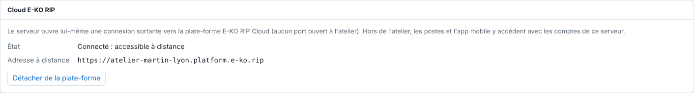
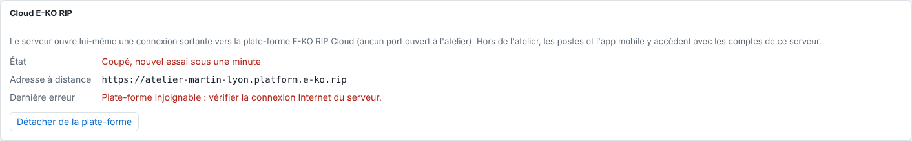

The server's **E-KO RIP Cloud** (*Cloud E-KO RIP*) section shows whether remote access is working.
It gives the remote address and the last error, if any.

## Before you start

- Open the server's administration interface with an administrator account.
- From the client, open **Administration…**, then the **System** (*Système*) view.

## Steps

1. Open **System**, then the **E-KO RIP Cloud** section.
2. Read the **Status** line (*État*):

   | Status shown | Meaning |
   |---|---|
   | **Not linked** (*Non rattaché*) | The server is not linked to the platform. |
   | **Connecting…** (*Connexion en cours…*) | The server is opening its connection to the platform. |
   | **Connected: reachable remotely** (*Connecté : accessible à distance*) | Everything works: the **Remote address** (*Adresse à distance*) is shown. |
   | **Disconnected, retrying within a minute** (*Coupé, nouvel essai sous une minute*) | The connection dropped; the server retries by itself. |

   
3. If a **Last error** (*Dernière erreur*) is shown, read it. For example, **Platform unreachable: check the server's Internet connection.** (*Plate-forme injoignable : vérifier la connexion Internet du serveur.*) points to an Internet connection problem.

   
4. Wait a minute: after an outage, the server reconnects by itself (it first waits 1 second, then 2, and so on up to 60 seconds).

## Good to know

- The buttons change with the status: **Connect to the platform** (*Connecter à la plate-forme*) when the server is not linked, **Cancel** (*Abandonner*) while waiting for a code, **Unlink from the platform** (*Détacher de la plate-forme*) when it is linked.
- If the text "Le cloud demande au moins un compte sur ce serveur" (the cloud requires at least one account on this server) appears, see [Fix "the cloud requires at least one account"](../rip-cloud-depannage/rip-cloud-cloud-demande-un-compte.md).
- A server that has never been linked shows **Not linked**.

## See also

- [Link a RIP server to the cloud](rip-cloud-relier-un-serveur.md)
- [Fix an offline site](../rip-cloud-depannage/rip-cloud-site-hors-ligne.md)
- [Understand the cloud's error messages](../rip-cloud-depannage/rip-cloud-comprendre-les-messages-d-erreur.md)
