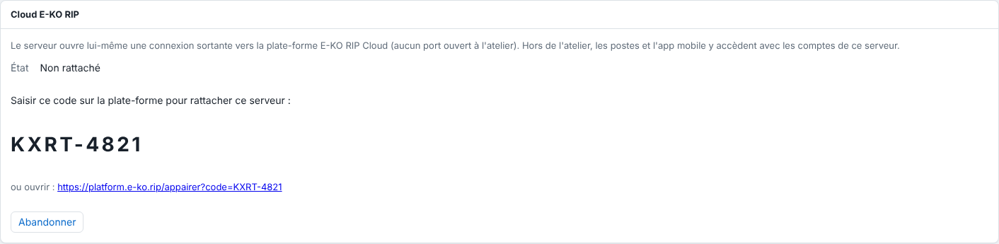
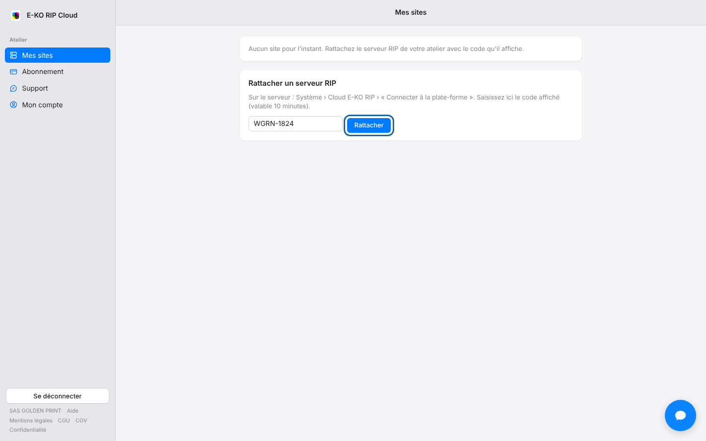

Linking the server lets you reach it from outside the workshop.
You need a code on the server, then you enter it on the portal.

## Before you start

- The server must have **at least one user account**. Without an account, access to the server is open on the local network, and the cloud refuses to open so as not to leave the workshop open to everyone. See [Create the server's accounts](../rip-administration/rip-creer-les-comptes.md).
- The server must have Internet access.
- Your platform e-mail address must be confirmed.
- Allow two minutes. You can link up to 10 sites per account (within the limit of your plan).

## Steps

1. Open the RIP server's administration interface, with an administrator account.
2. Go to **System › E-KO RIP Cloud** (*Système › Cloud E-KO RIP*).
3. Click **Connect to the platform** (*Connecter à la plate-forme*). The server shows a short code, such as `KXRT-4821`, valid for **10 minutes**.

   
4. On the portal, sign in with your account.
5. Go to **My sites** (*Mes sites*), section **Link a RIP server** (*Rattacher un serveur RIP*).
6. Enter the code, then click **Link** (*Rattacher*).

   

A few seconds later, **System › E-KO RIP Cloud** shows **Connected: reachable remotely** (*Connecté : accessible à distance*) and displays the **Remote address** (*Adresse à distance*).

The site appears in **My sites**, with its remote address, its status and your role.

## Good to know

- Under the code, the server also shows a link: opening it leads straight to the code entry page.
- The account that enters the code becomes the owner of the site.
- The suggested site name is the machine's name. To suggest another, the server administrator sets `EKO_RIP_CLOUD_NOM` in `/etc/default/eko-rip-serveur`. The `EKO_RIP_CLOUD_URL` variable in the same file points to another platform (for testing); it stays empty in normal use.
- If you change your mind before entering the code, click **Cancel** (*Abandonner*) on the server.
- After a network outage, the server reconnects by itself.
- Linking is done only from the workshop, never through the cloud.
- If the code is refused or has expired, see [Fix an expired or refused linking code](../rip-cloud-depannage/rip-cloud-code-expire.md).
- If the screen shows "Le cloud demande au moins un compte sur ce serveur" (the cloud requires at least one account on this server), see [Fix "the cloud requires at least one account"](../rip-cloud-depannage/rip-cloud-cloud-demande-un-compte.md).

## See also

- [Install the RIP server](../rip-premiers-pas/rip-installer-le-serveur.md)
- [Read the cloud status on the server](rip-cloud-lire-l-etat-du-cloud-sur-le-serveur.md)
- [Access your server remotely](rip-cloud-acceder-a-distance.md)
- [The code has expired or is refused](../rip-cloud-depannage/rip-cloud-code-expire.md)
