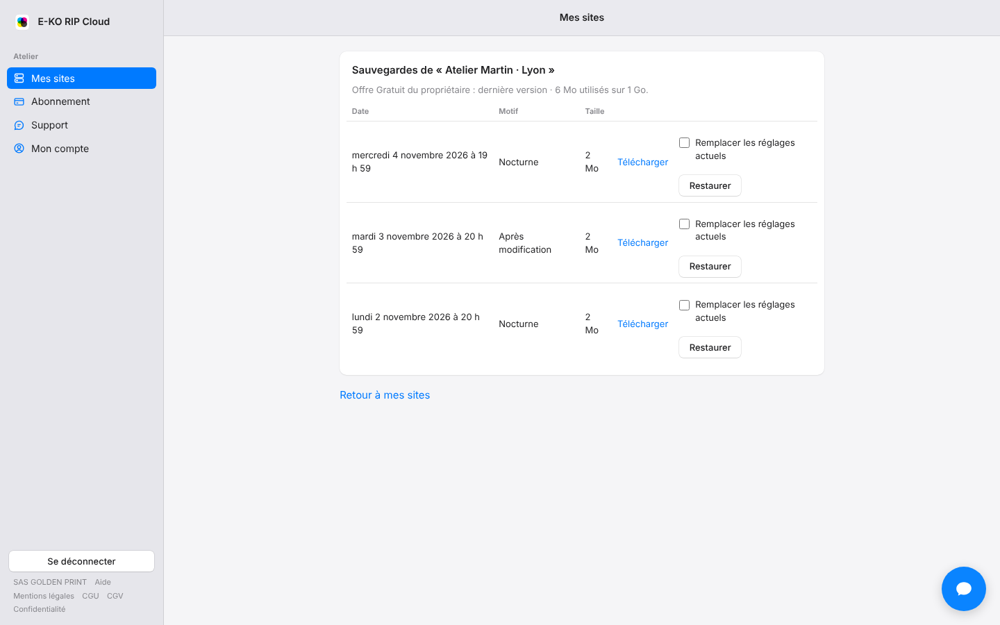

The number of versions kept and the space available depend on your plan.
This article explains the rules so there are no surprises.

## Before you start

- Open **My sites** (*Mes sites*), then **Backups** (*Sauvegardes*): the header shows the plan and the space used (for example "Offre Gratuit du propriétaire : dernière version · 6 Mo utilisés sur 1 Go", meaning the owner's Free plan: latest version, 6 MB used out of 1 GB).
- Backups contain neither jobs nor accounts.

## Steps

1. Find your plan in the table.

   | Plan | Online backups | Storage |
   |---|---|---|
   | Free | latest version | 1 GB |
   | Per machine | 30 versions | 5 GB per machine |
   | Atelier | 90 days of history | 25 GB |
   | Pro | 1 year of history, restore to another site | 100 GB |

2. Open **My sites › Backups** and compare the space used with the plan's storage.

   
3. If space is nearly full, subscribe to a larger plan or let the rotation free up versions. See [Change plan, payment method or cancel](../rip-cloud-abonnement/rip-cloud-changer-ou-resilier.md).

## Good to know

- The most recent version is always kept.
- The server sends a backup every night (at a random minute between 1 a.m. and 5 a.m., server time), about 2 minutes after a configuration change, and on request by an administrator. A backup identical to the previous one is not stored twice; the nightly one is still sent and confirms to the platform that the server is backing up.
- On a plan without online backup, the server does not insist until a plan allows it.
- When the quota is full, the platform warns the owner and refuses new backups until there is room. See [Understand backup space and failure alerts](rip-cloud-alertes-de-sauvegarde.md).
- When the account returns to the Free plan, existing versions are kept for 90 days, then only the latest one is kept.
- When a site is removed, its backups are deleted 90 days after the last one.
- The maximum size of an uploaded archive is 200 MB.

## See also

- [Understand online backups](rip-cloud-comprendre-les-sauvegardes.md)
- [Choose a plan](../rip-cloud-abonnement/rip-cloud-choisir-une-offre.md)
- [Download an online backup](rip-cloud-telecharger-une-sauvegarde.md)
