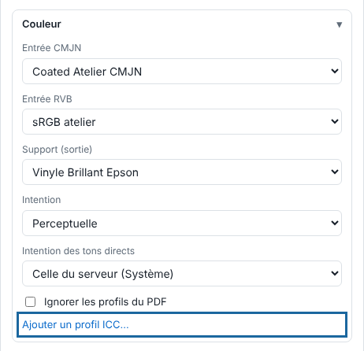

The **Colour** (*Couleur*) block decides how the file's colours become inks. This article is for the person who sets up rendering.

## Before you start

You have the `.icc` or `.icm` profile of the media, supplied by its maker or produced in the workshop. Adding a profile requires an administrator account.

## Steps

1. In **Administration…** (*Administration…*), **Production** (*Production*) view, click **Import** (*Importer*), then open the **Colour** block.
2. Click **Add an ICC profile…** (*Ajouter un profil ICC…*) and choose the file. It is stored on the server.

   
3. Choose the **CMYK input** (*Entrée CMJN*) and the **RGB input** (*Entrée RVB*): the profile applied to data that has none.
4. Choose the **Media (output)** (*Support (sortie)*) profile: the preview simulates how the printed media will look.
5. Choose the **Intent** (*Intention*): perceptual, relative colorimetric, saturation or absolute.
6. Tick **Ignore the PDF profiles** (*Ignorer les profils du PDF*) to apply these profiles to all the data.
7. If you want to reuse these choices, click **Save…** (*Enregistrer…*), next to **Preset** (*Réglage*), to keep them in a preset.

## Good to know

- Spot colours that have their own ink (`White`, `Silver`…) are never converted.
- To retouch the colours of a single job, use the viewer's **Colour filter** (*Filtre couleur*; **Colour** button): curves, brightness, saturation and colour replacement.
- A change applies to the following renders: retry a job that has already been rendered.

## See also

- [Declare the workshop's spot colours](rip-declarer-les-tons-directs.md)
- [Set up a media and its print modes](rip-regler-un-support-et-ses-modes.md)
- [Make a TIFF proof](rip-faire-une-epreuve-tiff.md)
