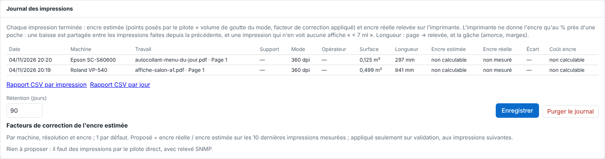

The log keeps every finished print with what it consumed. This article is for the administrator and production managers.

## Before you start

To measure the actual ink, the Epson must be driven with a **Network (TCP)** (*Réseau (TCP)*) connection with an **SNMP** address. Without SNMP, the actual ink reads **non mesuré** (not measured).

## Steps

1. Open **Administration…** (*Administration…*), **System** (*Système*) view, **Print log** (*Journal des impressions*) section: the last 200 prints, the most recent at the top.

   
2. Read the columns: **Date** (*Date*), **Machine** (*Machine*), **Job** (*Travail*; and its page), **Media** (*Support*), **Mode** (*Mode*), **Operator** (*Opérateur*; the one on the job ticket), **Area** (*Surface*), **Length** (*Longueur*), **Estimated ink** (*Encre estimée*), **Actual ink** (*Encre réelle*), **Gap** (*Écart*) and **Ink cost** (*Coût encre*). Hovering over the estimated or actual ink gives the detail per ink (BK, C, LC…).
3. To set the retention, enter the **Retention (days)** (*Rétention (jours)*; 90 by default), then **Save** (*Enregistrer*).
4. To empty the log, click **Purge the log** (*Purger le journal*) and say how many recent days to keep (0: erase everything).

## Good to know

- **Actual ink**: with the direct driver, the server reads the Epson (SNMP) just before sending and just after the print ends, in addition to the reading every minute. What dropped between the two is stored in the output; the queue shows it on the finished output's line: `Relevé : encre 14 ml, support 574 mm` (reading: ink 14 ml, media 574 mm).
- The printer reports ink only to the nearest 1% of a pouch (1% of 700 ml = 7 ml): a print that sees no drop shows **< 7 ml**, never 0. A 1% drop happened since the previous change of the same channel: it is shared among all the prints made since, in proportion to their estimated ink (or, failing that, their duration). A single figure remains approximate; the sum over a period is reliable.
- A drop outside any print (cleaning) is attributed to no one; a pouch change is not consumption.
- The capacity of a pouch is that of the cartridge entered in **Ink and media costs** (*Coûts d'encre et de support*; the line for the ink, its plate or **All the others** (*Toutes les autres*)), otherwise 700 ml.
- **Length**: `369 → 574 mm (gâche 204 mm)`: the page length, the length read on the roll between start and end, and the difference (leader, empty head, margins; "gâche" means waste). To be checked in the workshop on a real print (job of 369.8 mm, 574 mm read, so 204 mm of waste).
- **Estimated ink**: with the direct driver, the dots laid by screening are counted ink by ink and size by size; *ml = Σ dots × drop volume of the mode*, multiplied by the validated correction factor. An output to a folder (continuous-tone plates, screened by other software) is **non calculable** (not computable): no ink and no ink cost, rather than a wrong figure. The estimate shown on the job card before printing remains the one based on the preview's coverage.
- The purge runs every 5 minutes. Jobs and the queue are never touched; the printer readings remain.
- The retention is included in the configuration backup.

## See also

- [Export the CSV consumption reports](rip-exporter-les-rapports-csv-de-consommation.md)
- [Correct the ink estimate with correction factors](rip-corriger-l-estimation-d-encre.md)
- [Set the ink and media costs](rip-regler-les-couts-d-encre-et-de-support.md)
