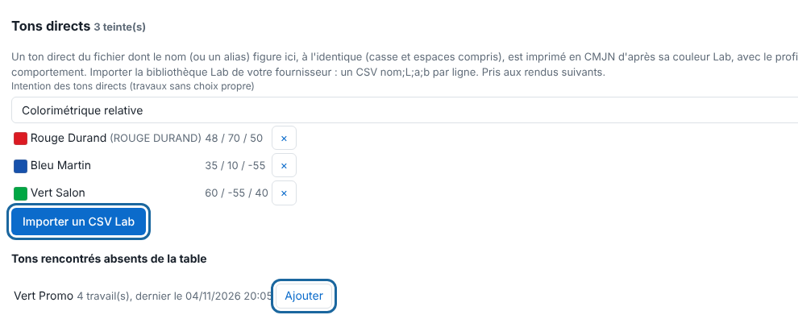
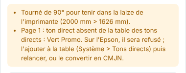

A spot colour in the file (a named shade) has no ink of its own: the RIP prints it in CMYK. The spot colour table gives it the right colour.

## Before you start

You need an administrator account. To import a library, you have a CSV of Lab values that you are allowed to use: no library is supplied with the RIP.

## Steps

1. Open **Administration…** (*Administration…*), then the **System** (*Système*) view, **Spot colours** (*Tons directs*) section.

   
2. To know which colours to declare, send a file that uses them: a colour missing from the table is flagged in the job's inspector.

   
3. In **Colours found but missing from the table** (*Tons rencontrés absents de la table*), click **Add** (*Ajouter*) next to the colour, then enter its Lab colour in the form `L a b` (for example `48 68 48`).
4. To import in one go, click **Import a Lab CSV** (*Importer un CSV Lab*). Each line is written `name;L;a;b`.
5. Set the **Spot colour intent** (*Intention des tons directs*; relative colorimetric by default).
6. To remove a colour, click **×** on its line and confirm.
7. Retry the jobs that have already been rendered: the table is taken into account only by the following renders.

## Good to know

- The name must be identical: case and spaces count ("PANTONE 485 C" does not find "Pantone 485 C").
- If a name in the CSV already exists, the whole import is refused, with nothing written.
- `White`, `Silver`, `Metallic` and the cut spot colours cannot go in the table.
- A colour of the file that is missing from the table is flagged on the page ("ton direct absent de la table des tons directs", spot colour missing from the spot colour table) and listed in **Colours found but missing from the table**: **Add** brings it in with its Lab value.
- A colour written in several ways in your files is added once per spelling.
- **Spot colour intent**: relative colorimetric by default (the aim is the shade). A preset or a job can choose another (**Colour** block, "Spot colour intent"). Changing the server's intent affects only the jobs left on "Celle du serveur" (the server's), at the following renders. With the RIP's basic profiles, perceptual and relative give the same result; with a media's ICC profile, they differ.
- The job reports the conversion ("Tons directs imprimés en CMJN d'après la table", spot colours printed in CMYK from the table); the conversion goes through the output profile and the job's intent, and the preview shows the Lab colour.
- Your supplier's CSV (for example a swatch book) accepts `;`, tab or `,` as separator, and the decimal comma with `;`. Import only the libraries you are allowed to use.
- A 50% tint lays half of the CMYK recipe of the full colour.

## See also

- [Choose the colour profiles of a job](rip-choisir-les-profils-de-couleur.md)
- [Lay down white automatically](rip-poser-du-blanc-automatique.md)
- [Send a job to the RIP](../rip-travaux/rip-envoyer-un-travail.md)
