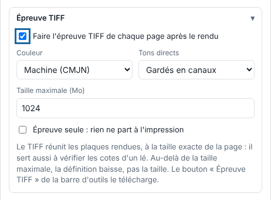
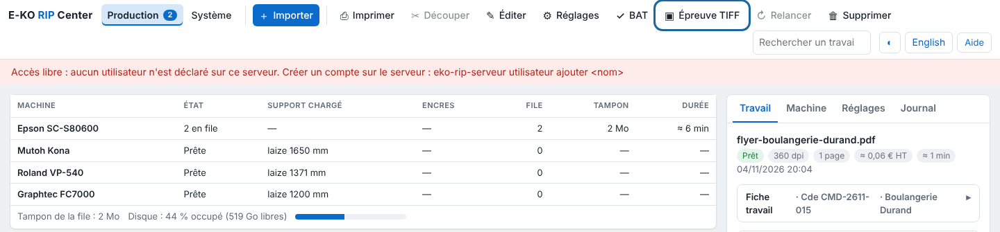

The TIFF proof is made from the rendered plates, so from what is sent to the machine, at the exact size of the page. It also serves to check the dimensions of a panel.

## Before you start

The job's render is finished. No particular right is required.

## Steps

1. In **Administration…** (*Administration…*), **Production** (*Production*) view, click **Import** (*Importer*), then open the **TIFF proof** (*Épreuve TIFF*) block.
2. Tick **Make the TIFF proof of each page after rendering** (*Faire l'épreuve TIFF de chaque page après le rendu*) to have it as soon as the render ends.

   
3. Choose the **Colour** (*Couleur*): **Machine (CMYK)** (*Machine (CMJN)*) for the ink values as sent, or **Colorimetric (RGB)** (*Colorimétrique (RVB)*) to see the on-screen look.
4. Choose what happens to the **Spot colours** (*Tons directs*): **Kept as channels** (*Gardés en canaux*), **Flattened into the colour** (*Aplatis dans la couleur*) or **Removed** (*Supprimés*).
5. Set the **Maximum size (MB)** (*Taille maximale (Mo)*; 1 to 3500 MB, uncompressed).
6. For a job already received, click it in the table, then click **TIFF proof** in the toolbar: the proof is made on demand and downloaded.

   

## Good to know

- Beyond the maximum size, the resolution drops but the physical size stays exact.
- **Proof only** (*Épreuve seule*): the proof is made after the render and nothing is sent to print, but the job can still be cut.
- Cut spot colours are never in the proof.
- A proof that fails does not stop the job: it is flagged in its alerts.
- These settings are kept in a saved preset.

## See also

- [Approve a proof with the client](../rip-travaux/rip-valider-un-bat.md)
- [Choose the colour profiles of a job](rip-choisir-les-profils-de-couleur.md)
- [Send a job to the RIP](../rip-travaux/rip-envoyer-un-travail.md)
