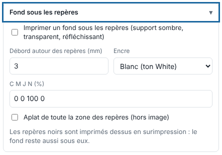

On dark, transparent or reflective media, the Kona reads black marks poorly. A background of ink under them solves the problem. This article is for operators.

## Before you start

The job is in **Print** (*Imprimer*) mode with **Kona registration** (*Repérage Kona*; see [Choose the Kona registration](../rip-machines/rip-choisir-le-reperage-kona.md)).

## Steps

1. Click **Import** (*Importer*) and open the **Background under the marks** (*Fond sous les repères*) block.
2. Tick **Print a background under the marks (dark, transparent, reflective media)** (*Imprimer un fond sous les repères (support sombre, transparent, réfléchissant)*): a strip of ink extends beyond each mark and barcode.
3. Set the **Spill around the marks (mm)** (*Débord autour des repères (mm)*), from 0.5 to 13 mm.
4. Choose the **Ink** (*Encre*): white (`White` spot colour) or CMYK, whose values you enter in %.
5. For the whole marks area, tick **Solid over the whole marks area (outside the image)** (*Aplat de toute la zone des repères (hors image)*).

   
6. Click **Send to the RIP** (*Envoyer au RIP*).

## Good to know

- The black marks are printed on top in overprint: the background stays under them as well.
- A sheet nests only jobs with the same background under the marks.
- With white, the printer must have a white ink.

## See also

- [Choose the Kona registration](../rip-machines/rip-choisir-le-reperage-kona.md)
- [Lay down white automatically](rip-poser-du-blanc-automatique.md)
- [Connect the Mutoh Kona 1650](../rip-machines/rip-brancher-mutoh-kona-1650.md)
