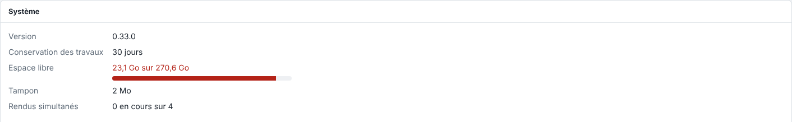

The **System** (*Système*) view brings together the server's status and most of its settings. This article gives its layout, for administrators.

## Before you start

An **Operator** (*Opérateur*) account sees the status; the blocks reserved for the administrator require an administrator account.

## Steps

1. Open the **System** view next to **Production** (*Production*).

   
2. Read the first block: the server version, the job retention period (30 days by default, set by `EKO_RIP_CONSERVATION_JOURS`), the free space of the data disk (red below 10%), the spool and the simultaneous renders.
3. Read "Fichiers et dossiers" (files and folders): a missing or damaged folder or status file is flagged there.
4. Scroll down through the blocks: **Cutting** (*Découpe*), **Spot colours** (*Tons directs*), **ERP bridge** (*Pont ERP*), **E-KO RIP Cloud** (*Cloud E-KO RIP*), **Anonymous statistics** (*Statistiques anonymes*), **Bug reports** (*Rapports de bug*), **Machines** (*Machines*), **Media loaded in the Epson** (*Média chargé dans l'Epson*), **Print log** (*Journal des impressions*), **Epson media** (*Supports de l'Epson*), **Automatic folder rules** (*Règles du dossier automatique*), **Ink and media costs** (*Coûts d'encre et de support*) and **Configuration backup** (*Sauvegarde de la configuration*).

## Good to know

- The **Cutting** block (administrator) holds the cutting prefixes, the non-printable layers, the open paths, the path sorting and the **After cutting** (*Après coupe*) choice (see [Set the cutting prefixes](../rip-travaux/rip-regler-les-prefixes-de-decoupe.md)).
- The **Machines**, **Epson media**, **Automatic folder rules**, **Costs** and **Backup** blocks are shown only to the administrator.
- The data disk can also be read in the **Production** view (see [Read the Production screen](../rip-travaux/rip-lire-l-ecran-production.md)).
- Jobs are purged after the retention period; below 5 GB free, the server itself deletes the oldest inactive jobs.

## See also

- [Read the Production screen](../rip-travaux/rip-lire-l-ecran-production.md)
- [Back up the server configuration](../rip-administration/rip-sauvegarder-la-configuration.md)
- [Add a machine to the RIP](../rip-machines/rip-ajouter-une-machine.md)
