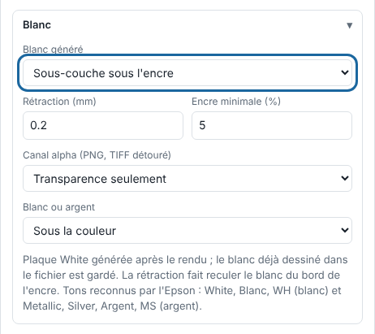

White stops the colour from getting lost on transparent or coloured media. The RIP can generate it itself after rendering.

## Before you start

The printer has a white ink. The job is in **Print** (*Imprimer*) mode. Note that white and silver do not yet go through the Epson direct driver: see [Connect the Epson SC-S80600](../rip-machines/rip-brancher-epson-sc-s80600.md).

## Steps

1. In **Administration…** (*Administration…*), **Production** (*Production*) view, click **Import** (*Importer*), then open the **White** (*Blanc*) block.
2. In **Generated white** (*Blanc généré*), choose **Underlay under the ink** (*Sous-couche sous l'encre*) for white wherever an ink exceeds the **Minimum ink (%)** (*Encre minimale (%)*; 5 by default), or **Solid over the whole page** (*Aplat sur toute la page*) for white over the whole page.

   
3. Set the **Choke (mm)** (*Rétraction (mm)*; 0.2 mm by default, up to 5 mm): the white is pulled back from the edge of the ink so that it does not stick out past the colour.
4. In **White or silver** (*Blanc ou argent*), choose to lay the white **Under the colour** (*Sous la couleur*) or **Over the colour (window graphics)** (*Sur la couleur (vitrophanie)*).
5. Send the job, then open **Layers** (*Couches*) in the inspector to see the `White` plate.
6. To keep this choice, click **Save…** (*Enregistrer…*), next to **Preset** (*Réglage*), to add it to a preset.

## Good to know

- White already drawn in the file (`White` spot colour) is kept: the final white combines the two.
- The recognised names are `White`, `Blanc` or `WH` for white; `Metallic`, `Silver`, `Argent` or `MS` for silver.
- The generated plate appears in the previews, counts in the cost and goes to the Epson with the other plates (with a Folder connection for now). A saved preset keeps the white choice.
- For the recognised names and the details of the plates, see [Understand ink plates and spot colour names](rip-comprendre-les-plaques-et-les-tons-directs.md).
- On a plate, black is the ink and white is the absence of ink.
- For a cut-out PNG or TIFF, the **Alpha channel** (*Canal alpha*) setting can give a `White` or `Varnish` plate that follows the cut-out: see [Lay down white or varnish from an alpha channel](rip-poser-du-blanc-ou-du-vernis-depuis-un-canal-alpha.md).

## See also

- [Declare the workshop's spot colours](rip-declarer-les-tons-directs.md)
- [Connect the Epson SureColor SC-S80600](../rip-machines/rip-brancher-epson-sc-s80600.md)
- [The output to the machine failed](../rip-depannage/rip-sortie-vers-la-machine-echouee.md)
