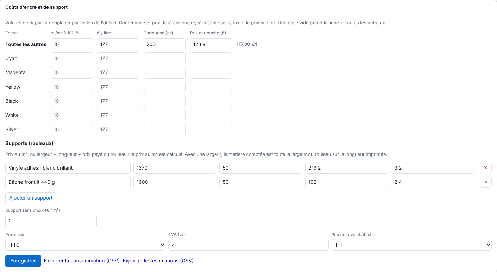

Each page shows its area, the estimated ink and its cost. This article explains how to set the workshop's rates. It is for the administrator.

## Before you start

You need an administrator account and your prices: cartridge and roll invoices, or the weighing of a known print.

## Steps

1. Open **Administration…** (*Administration…*), **System** (*Système*) view, **Ink and media costs** (*Coûts d'encre et de support*) section.

   
2. For each ink, enter the **ml/m² at 100%** and the **€ / litre**. The **All the others** (*Toutes les autres*) line applies to the empty boxes.
3. Or enter the capacity (ml) and the price of a **cartridge**: the price per litre is derived from it.
4. In **Media (rolls)** (*Supports (rouleaux)*), click **Add a media** (*Ajouter un support*): give its name and either its price per m², or its width, its length and the price paid for the roll (the price per m² is computed).
5. Set **Prices entered** (*Prix saisis*; **Incl. tax** (*TTC*) or **Excl. tax** (*HT*)), the **VAT** (*TVA*) rate (20% by default) and the **Cost price shown** (*Prix de revient affiché*; excl. tax by default).
6. Click **Save** (*Enregistrer*).
7. When sending, choose the media in **Media (cost price)** (*Support (prix de revient)*; kept in the presets). The job card then shows its **cost price** (*prix de revient*; ink + material).

## Good to know

- The calculation: for each plate, *rate × area × ml/m² at 100%* gives the ml, then *ml ÷ 1000 × price per litre* the cost; the media costs *area × price per m²*. Cut spot colours do not count. Under each plate thumbnail, its ink rate is shown (share of the page covered at 100%).
- A page shows, for example: `0,42 m² · encre 3,1 ml · ≈ 1,92 € (encre 0,44 €, support 1,48 €)` (ink 3.1 ml, ink cost 0.44, media cost 1.48).
- The supplied values (10 ml/m², Epson cartridge of 700 ml at 123.90 incl. tax, i.e. 177 per litre, HEXIS V3000WG media at 1.97 per m² in a roll of 1600 mm × 45 m) are starting values: replace them with the workshop's own.
- A change of rate also applies to jobs already done.
- With a known width, the material counted is the whole roll width over the printed length. Without a known width, the media counted is the page area, not the roll length consumed across the whole width.
- The card, each page's estimate and the CSV (`base` column) follow the excl.-tax or incl.-tax choice.
- The reports can be downloaded: see [Export the CSV consumption reports](rip-exporter-les-rapports-csv-de-consommation.md).

## See also

- [Export the CSV consumption reports](rip-exporter-les-rapports-csv-de-consommation.md)
- [Consult the print log](rip-consulter-le-journal-des-impressions.md)
- [Set up a media and its print modes](rip-regler-un-support-et-ses-modes.md)
