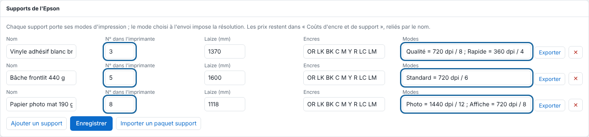

The media catalogue links what you load into the Epson to the render resolution and to the rates. This article is for the administrator.

## Before you start

You need an administrator account. First register the media in the Epson under a number, and note that number.

## Steps

1. Open **Administration…** (*Administration…*), then the **System** (*Système*) view, **Epson media** (*Supports de l'Epson*) section.
2. Click **Add a media** (*Ajouter un support*) and enter its **Name** (*Nom*).
3. Enter the **Number in the printer** (*N° dans l'imprimante*), that is, the number registered in the Epson. It lets the loaded media be recognised.
4. Enter the **Roll width (mm)** (*Laize (mm)*) and the **Inks** (*Encres*).
5. Write its print **Modes** (*Modes*), separated by semicolons: `Nom = 720 dpi / 8 passes ; Autre = 360 dpi / 4`.

   
6. Click **Save** (*Enregistrer*).
7. When sending a job (**Import**, *Importer*), choose the media in **Media and print mode** (*Support et mode d'impression*): the mode sets the render resolution.

## Good to know

- **— résolution choisie à la main —** (resolution chosen by hand) keeps the resolution of the sending panel.
- Changing the mode on a received job redoes the render.
- The loaded media is recognised by its number read from the printer, or chosen by hand in the list (the choice takes precedence until you go back to **— lu sur l'imprimante —**, read from the printer). A print waits until the loaded media is the job's (**Autre support**, other media), then starts by itself.
- **Export** (on a media's line) creates a package that **Import a media package** (*Importer un paquet support*) takes in on another server.
- A third optional field of a mode gives the volume of the small, medium and large drops for the estimated ink: `Autre = 360 dpi / 4 / 5-10-15 pL`. Without it, 5-10-15 pL (starting values to be calibrated). Each media and each mode keeps a stable identifier: renaming it does not change it.
- The separation of the light inks and the total ink of a mode can also be set: see [Set the light inks and total ink of a mode](rip-regler-les-encres-claires-et-l-encre-totale.md).
- A media can be carried from one server to another: see [Share a media with a media package](rip-partager-un-support-avec-un-paquet.md).
- Media and ink prices are set in **System › Ink and media costs** (*Système › Coûts d'encre et de support*): replace the starting values with the workshop's own.
- **System › Media loaded in the Epson** (*Système › Média chargé dans l'Epson*) screen: the roll width of the loaded roll, read over the network, is taken over with **Use as roll width** (*Utiliser comme laize*).

## See also

- [Connect the Epson SureColor SC-S80600](../rip-machines/rip-brancher-epson-sc-s80600.md)
- [Choose the colour profiles of a job](rip-choisir-les-profils-de-couleur.md)
- [Send a job to the RIP](../rip-travaux/rip-envoyer-un-travail.md)
