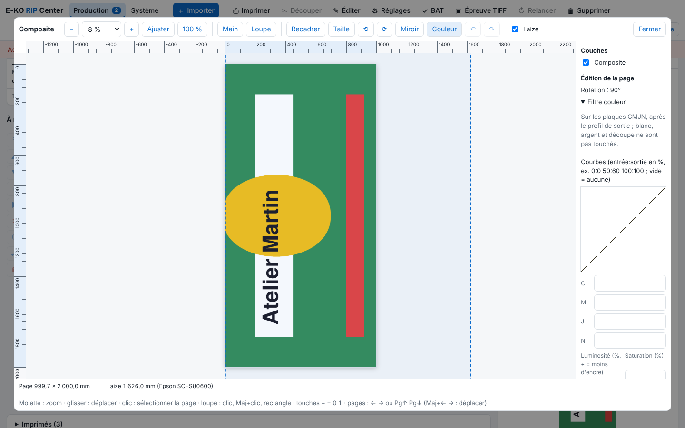

The colour filter retouches a job without going back to the layout software. It is specific to the job. This article is for operators.

## Before you start

The job is a rendered PDF, with no tiling. The filter acts on the CMYK plates, after the output profile and before automatic white; white, silver and cutting are not touched.

## Steps

1. Open the job in the viewer (see [Use the viewer to check a job](../rip-travaux/rip-utiliser-la-visionneuse.md)), then click **Colour** (*Couleur*): the **Colour filter** (*Filtre couleur*) block opens on the right.

   
2. For a curve, enter "input:output" points in % in C, M, J or N (for example `0:0 50:60 100:100`), 16 at most; empty = none. The fields are labelled C, M, J, N (cyan, magenta, yellow, black).
3. Set the **Brightness** (*Luminosité*; + = less ink) and the **Saturation** (*Saturation*), from −100 to 100%.
4. To change a hue, click **Add a replacement** (*Ajouter un remplacement*): choose a CMYK hue **From** (*De*) and a CMYK hue **To** (*Vers*), with a **Range** (*Plage*; ± %). 20 replacements at most; the **Active** (*Actif*) checkbox turns them on, **Remove** (*Retirer*) deletes them. The replacement comes before the rest of the filter.
5. To compare, use **Before / after (left: before)** (*Avant / après (gauche : avant)*): a split preview on a filter already rendered; the slider moves the split.
6. Click **Apply** (*Appliquer*): the render is redone.
7. To reuse the filter, click **Export to the preset** (*Exporter vers le réglage*) and choose a saved preset, or **New preset (this job's settings)** (*Nouveau réglage (réglages de ce travail)*). The filter is taken up again on import.
8. To remove it, click **No filter** (*Sans filtre*).

## Good to know

- The "after" estimates the effect on the on-screen proof.
- A colour filter is mentioned on the proof, but the proof does not show it (see [Approve a proof with the client](../rip-travaux/rip-valider-un-bat.md)).
- For ICC profiles, see [Choose the colour profiles of a job](rip-choisir-les-profils-de-couleur.md).

## See also

- [Choose the colour profiles of a job](rip-choisir-les-profils-de-couleur.md)
- [Use the viewer to check a job](../rip-travaux/rip-utiliser-la-visionneuse.md)
- [Crop, resize or rotate a page](../rip-travaux/rip-recadrer-redimensionner-ou-tourner-une-page.md)
