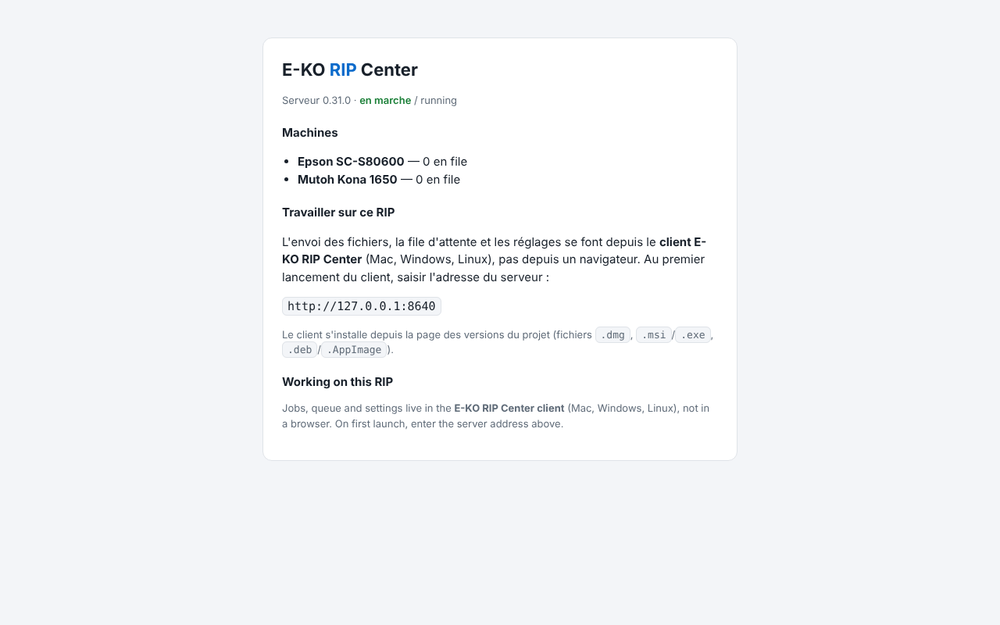

If you open the server address in a browser, you only see a status page. This is intentional: the full interface lives only in the E-KO RIP Center client.

## Before you start

You know the server address and the client is installed on your workstation (Mac, Linux or Windows).

## Steps

1. Note the status page: server version, machines and the address to enter in the client.

   
2. To work, open the client: see [Connect to the server from a workstation](../rip-premiers-pas/rip-se-connecter-au-serveur.md).
3. For settings, open the **Administration…** menu of the client.
4. From outside the workshop, open the site address on the Cloud in a browser: see [Access your server remotely](../rip-cloud-premiers-pas/rip-cloud-acceder-a-distance.md).

## Good to know

- A browser request to the API receives "Réservé au client E-KO RIP Center" ("Reserved for the E-KO RIP Center client") (`client_requis`).
- This page is also a way to check that a server responds on the network: if it appears, the service is running and port 8640 is reachable.
- For development only, `EKO_RIP_ACCES_NAVIGATEUR=1` opens the full interface in a browser: do not enable it in production.

## See also

- [The client cannot find the server](rip-client-ne-trouve-pas-le-serveur.md)
- [Understand the parts of the RIP](../rip-premiers-pas/rip-comprendre-les-pieces-du-rip.md)
- [Change the server's advanced settings](../rip-administration/rip-modifier-les-reglages-avances-du-serveur.md)
