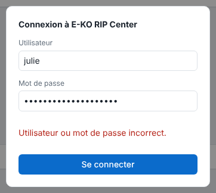
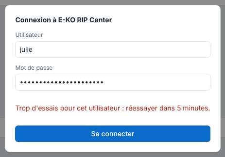
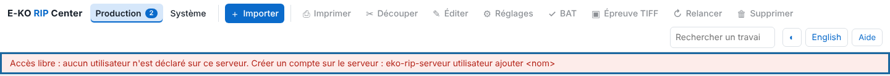

Three messages come up often around accounts. This article gives the cause of each and what to do.

## Before you start

Depending on the message, you need a terminal on the server or an administrator account.

## Steps

1. Read the exact message shown under the password.
2. For **"Utilisateur ou mot de passe incorrect."** (wrong user or password): check the name and password (including capitals), then try again.

   
3. For **"Trop d'essais pour cet utilisateur : réessayer dans 5 minutes."** (too many attempts): five wrong passwords have locked this name for 5 minutes. Wait, then try again.

   
4. If you forgot a password, an administrator declares the account again with `utilisateur ajouter`: the new password replaces the old one.
5. For **"Réservé à l'administrateur du RIP."** (reserved for the RIP administrator): your account is **operator**. Ask an administrator to make the change, or to give you the administrator role.
6. For **"Accès libre"** (open access) in red: no account is declared. Create an administrator account.

   

## Good to know

- Machines, media, rates, profiles, saved settings and backup are reserved for the administrator.
- Restarting the service unlocks a name immediately, but closes all sessions.
- A session lasts 12 hours: after that, the client asks you to sign in again.

## See also

- [Create the server accounts](../rip-administration/rip-creer-les-comptes.md)
- [Manage the server accounts](../rip-administration/rip-gerer-les-comptes.md)
- [The client cannot find the server](rip-client-ne-trouve-pas-le-serveur.md)
- [Report a problem to the team](rip-signaler-un-probleme.md)
