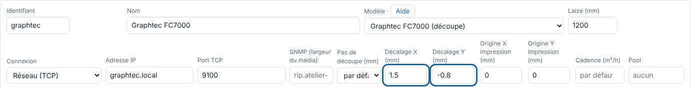

If the cut lands beside the printed design, a fixed machine offset is usually enough. This article is for the administrator.

## Before you start

You need an administrator account and a piece of media for a test cut.

## Steps

1. Send a small job that is printed and cut.
2. Measure the gap between the cut and the print.
3. In the client, open **Administration…**, the **System** view (*Système*), the **Machines** section, then the cutter's page.
4. Enter the gap in **X offset (mm)** (*Décalage X (mm)*) and **Y offset (mm)** (*Décalage Y (mm)*) (from −20 to 20 mm).

   
5. Click **Save** (*Enregistrer*), at the bottom of the **Machines** section.
6. Make another test cut and adjust if needed.

## Good to know

- The offset is added to every cut sent to this machine.
- If the cut comes out rotated by 180°, tick **Flipped cut (180°)** (*Découpe retournée (180°)*).
- In **Nesting** (*Mise en coupe*), **Offset the cut outwards (mm)** (*Décaler la coupe vers l'extérieur (mm)*) enlarges the piece, but does not replace this offset.
- For the Kona, also check the registration: frame with barcode (type 2).
- For a print that comes out curved after the dryers, use **Compensate for bowing** (*Compenser le cintrage*).

## See also

- [Connect the Mutoh Kona 1650](../rip-machines/rip-brancher-mutoh-kona-1650.md)
- [Connect the Graphtec FC7000](../rip-machines/rip-brancher-graphtec-fc7000.md)
- [Add a machine to the RIP](../rip-machines/rip-ajouter-une-machine.md)
- [Report a problem to the team](rip-signaler-un-probleme.md)
