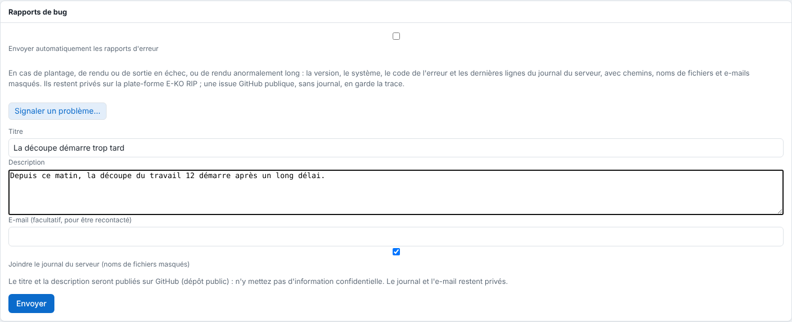

When you are stuck, the quickest way is to report the problem from the software: the report goes out with the information the team needs. This article explains how to send it and what is made public.

## Before you start

Note the exact message shown and the server version (**System** view, **Version** line; *Système*). Put no confidential information in the title or the description.

## Steps

1. Open the form:
   - on **Mac**: **Help** menu (*Aide*), then **Report a problem…** (*Signaler un problème…*);
   - on **Linux**: main menu, then **Report a problem…**;
   - in the **administration** (browser or Administration window): **System › Bug reports › Report a problem…** (*Système › Rapports de bug › Signaler un problème…*).
2. Enter the **Title** (*Titre*) and the **Description**: what you were doing, what you expected, what happened.
3. Fill in the **Email** (*E-mail*) (optional, so that you can be contacted).
4. Leave the **Attach the server log** box (*Joindre le journal du serveur*) ticked (file names are masked).

   
5. Click **Send** (*Envoyer*). The message "Merci, rapport envoyé (référence R-XXXXXXXX)." ("Thank you, report sent (reference R-XXXXXXXX).") appears: note the reference.

## Good to know

- **The title and description are published on GitHub** (issue in the public repository): put nothing confidential in them. The log and the email stay private.
- The workstation sends the report to its RIP server, which attaches its masked log (paths, file names and emails replaced) and forwards it to the E-KO RIP platform.
- You can also write to [contact@e-ko.rip](mailto:contact@e-ko.rip), giving the server version and the exact message.
- To have the server send its error reports on its own, see [Allow or refuse automatic error reports](../rip-administration/rip-autoriser-les-rapports-d-erreur-automatiques.md).
- What is new in each version is in the [release log](https://e-ko.rip/changelog/), with an email subscription.

## See also

- [Allow or refuse automatic error reports](../rip-administration/rip-autoriser-les-rapports-d-erreur-automatiques.md)
- [Monitor the server service](../rip-administration/rip-surveiller-le-service-du-serveur.md)
- [Fix a failed render or a rejected file](rip-un-rendu-echoue.md)
- [Contact support](../rip-cloud-depannage/rip-cloud-joindre-le-support.md)
