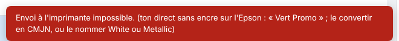
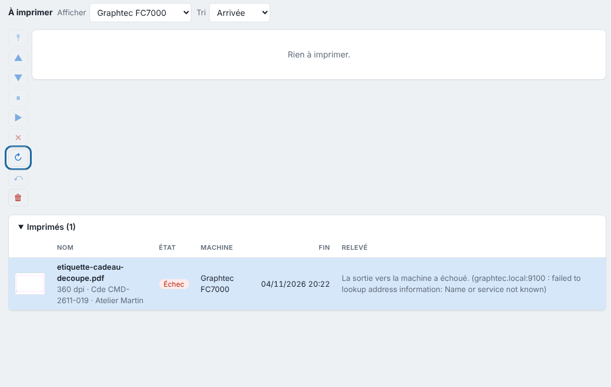

An output can fail between the server and the machine. The message is shown under the output, in the queue.

## Before you start

You can see the failed output in the machine's queue. Get access to the machine to clear a physical alert.

## Steps

1. Open **Printed** (*Imprimés*) in the **Production** view and click the failed output: the message appears in the **Report** column (*Relevé*).
2. For **"La sortie vers la machine a échoué."** ("The output to the machine failed."): check that the machine is switched on and reachable, that its USB port exists and that write permission is granted.
3. For **"L'imprimante signale une alerte : impression arrêtée."** ("The printer reports an alert: printing stopped."): clear the alert on the machine (cover open, empty cartridge…).
4. For **"Envoi à l'imprimante impossible."** ("Cannot send to the printer.") on the Epson, a red message appears when sending: rename the spot colour `White` or `Metallic`, convert it to CMYK, or add it to the spot colour table (**System › Spot colours**, *Système › Tons directs*). Then restart the job.

   
5. Once the cause is fixed, click the output in **Printed**, then **Redo** (*Refaire*, ↻), in the column of buttons to the left of the list.

   

## Good to know

- If a machine cannot be removed from the catalogue, it is because **an output is still waiting for this machine in the queue**: let it through or cancel it first.
- With a direct network connection, white and silver currently go through a machine with a **Folder** connection (*Dossier*).
- If the estimated duration does not match reality, measure the real throughput (m² per hour on the roll width) and enter it as the machine's **Throughput** (*Cadence*).
- No notification on the phone: check the permission in the phone settings and the app's **Notifications** switch.

- With a direct network connection (direct driver), white and silver are currently refused: go through a machine with a **Folder** connection. A page carrying both white and silver also triggers "Envoi à l'imprimante impossible.".
- The message "L'imprimante signale une alerte : impression arrêtée." comes from a blocking alert read over SNMP (cover open, empty cartridge…): clear it on the machine, then **Redo**.

## See also

- [Manage a machine's queue](../rip-travaux/rip-gerer-la-file-d-une-machine.md)
- [Choose a machine's connection](../rip-machines/rip-choisir-la-connexion-d-une-machine.md)
- [Connect the Epson SureColor SC-S80600](../rip-machines/rip-brancher-epson-sc-s80600.md)
- [Fix an Epson that does not respond or reports no media width](rip-epson-ne-repond-pas.md)
