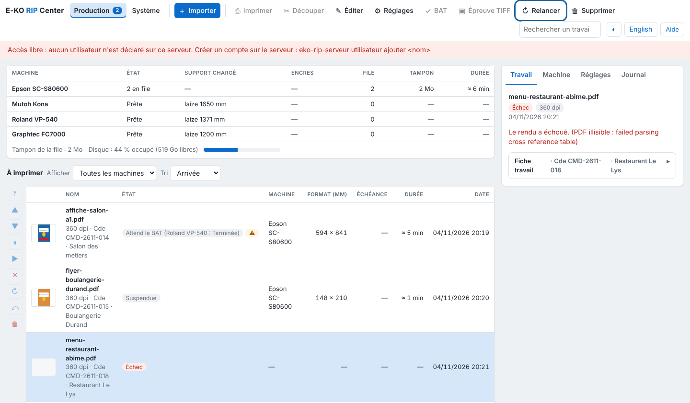

A render can fail because of the file, the time limit or disk space. This article helps you find the cause.

## Before you start

You can see the failed job in the client. To change a server setting, you need `sudo` access on the server.

## Steps

1. Click the job and read the message in the inspector.
2. Also look at the server log: `journalctl -u eko-rip-serveur -f`.
3. If the PDF is password-protected or damaged, save it again from the layout software.
4. If the message is "Fichier trop volumineux pour le serveur." ("File too large for the server."), raise the limit with `EKO_RIP_MAX_MO` in `/etc/default/eko-rip-serveur` (8 GB by default).
5. If the render exceeds the time limit (30 minutes by default), raise `EKO_RIP_DELAI_S` in the same file.
6. Restart the service: `sudo systemctl restart eko-rip-serveur`.
7. In the client, click **Retry** (*Relancer*) on the job.

   

## Good to know

- "Disque presque plein" ("Disk almost full"): less than 20 GB is left. Delete old jobs, shorten the retention period (`EKO_RIP_CONSERVATION_JOURS`) or enlarge the disk. Below 5 GB, the server itself deletes the oldest inactive jobs.
- "Permission denied" on every render under Ubuntu 26.04: update the server.
- Fonts that are not embedded and images with too low a resolution are flagged as soon as you send, in the job's alerts.
- A very large format (render over 3 GB) is rendered in bands then stitched back together: it takes longer, but there is nothing to set. Allow for the disk space.
- Restarting the server interrupts the render in progress: restart the job.

## See also

- [Send a job to the RIP](../rip-travaux/rip-envoyer-un-travail.md)
- [Update the server](../rip-administration/rip-mettre-a-jour-le-serveur.md)
- [Choose the server computer](../rip-premiers-pas/rip-choisir-le-poste-serveur.md)
- [Understand banded rendering of very large formats](rip-comprendre-le-rendu-par-bandes.md)
