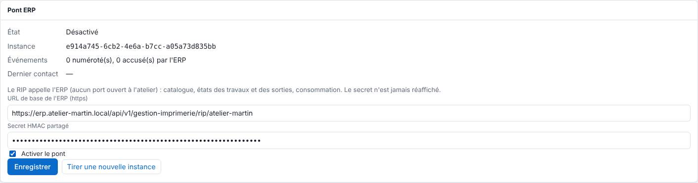

The **System › ERP bridge** screen (*Système › Pont ERP*) links the RIP to the ERP: URL, secret and activation. It also shows the bridge status. Reserved for the administrator.

## Before you start

You are signed in with an administrator account. You have created the secret (see [Create the ERP bridge token and secret](rip-creer-le-jeton-et-le-secret-du-pont-erp.md)) and you have the URL given by the ERP's bridge screen. The server must be able to reach the ERP over outbound HTTPS: no port to open.

## Steps

1. In the client, open **Administration…**, then the **System** view (*Système*), **ERP bridge** section (*Pont ERP*).
2. In **ERP base URL (https)** (*URL de base de l'ERP (https)*), enter the URL from the ERP's bridge screen, in the form `https://<host>/api/v1/gestion-imprimerie/rip/<workshop>`.
3. In **Shared HMAC secret** (*Secret HMAC partagé*), paste the 64-character secret (or leave it empty to keep the one that is saved).
4. Tick **Turn on the bridge** (*Activer le pont*).
5. Click **Save** (*Enregistrer*): the message "Pont ERP enregistré." ("ERP bridge saved.") appears.

   
6. Read the status: **Status** (*État*), **Instance**, **Events** (*Événements*) ("n numbered, n acknowledged by the ERP", plus those waiting to be sent), **Last contact** (*Dernier contact*) and **Last error** (*Dernière erreur*).

## Good to know

- The possible statuses are:

  | Status shown | Meaning |
  |---|---|
  | Désactivé | the bridge is not turned on |
  | Activé, mais l'URL ou le secret manque | fill in both fields |
  | Actif | exchanges are taking place |
  | Actif, en erreur (nouvel essai dans 1 à 5 min) | see [Fix an ERP bridge in error, replaced or in anomaly](rip-resoudre-un-pont-erp-en-erreur.md) |
  | Arrêté : ce RIP a été remplacé… | another installation has taken its place |
  | Arrêté : l'ERP compte plus d'événements… | counting anomaly |
- `https` is mandatory; `http` is only allowed to the machine itself, for testing.
- The secret is never shown again. The URL, the activation and the instance are included in the configuration backup, but not the secret.
- **Draw a new instance** (*Tirer une nouvelle instance*) (with confirmation) restarts the event log from 1: see [Understand ERP bridge instances](rip-comprendre-les-instances-du-pont-erp.md).
- With the bridge off, nothing is logged. On activation, existing jobs and outputs are taken as they are; only their later changes make an event.

## See also

- [Understand the ERP bridge](rip-comprendre-le-pont-erp.md)
- [Fix an ERP bridge in error, replaced or in anomaly](rip-resoudre-un-pont-erp-en-erreur.md)
- [Understand ERP bridge exchanges](rip-comprendre-les-echanges-du-pont-erp.md)
- [Back up the server configuration](../rip-administration/rip-sauvegarder-la-configuration.md)
