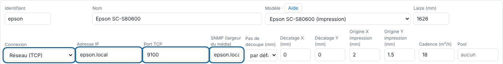
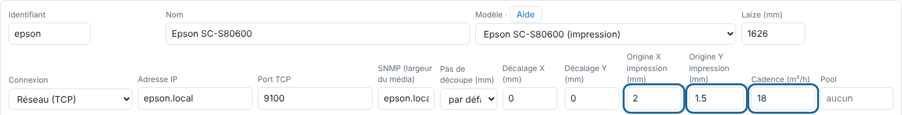

The RIP renders the plates, separates them across the Epson's 9 inks, screens them and sends the print itself (direct driver). This article describes the connection and the settings.

## Before you start

You need an administrator account, the Epson cabled to the server's network with a fixed address, and the media saved in the printer under a number.

## Steps

1. Connect the Epson with a network cable and reserve a fixed address for it.
2. In the client, open **Administration…**, the **System** view (*Système*), the **Machines** section, and add the machine with **Add a machine** (*Ajouter une machine*) (see [Add a machine](rip-ajouter-une-machine.md)).
3. Under **Connection** (*Connexion*), choose **Network (TCP)** (*Réseau (TCP)*), enter the Epson's address in **IP address** (*Adresse IP*) and keep **TCP port** (*Port TCP*) 9100: this is the direct driver.
4. Fill in the **SNMP (media width)** address (*SNMP (largeur du média)*): the Epson then reports its media width, its loaded media, its inks and its alerts.

   
5. Set the **Print origin X (mm)** (*Origine X impression (mm)*) and **Print origin Y (mm)** (*Origine Y impression (mm)*) using a paper test, and the **Throughput (m²/h)** (*Cadence (m²/h)*) measured in the workshop.

   
6. Click **Save** (*Enregistrer*), at the bottom of the **Machines** section.
7. In the **Epson media** section (*Supports de l'Epson*), declare your media with the number saved in the printer.
8. Check from the server: `nc -vz <epson-address> 9100`.
9. Scroll down to the **Media loaded in the Epson** section (*Média chargé dans l'Epson*): the roll width, the remaining roll and the inks should appear.

## Good to know

- The **IPP** (raw CUPS queue) and **Forwarding** (*Renvoi*) connections give the same stream. With a **Folder** connection (*Dossier*), nothing is printed: one file per channel (`K.tif`… `WH.tif`) and `envoi.json` are dropped in `sorties/<machine>/`.
- White and silver do not yet go through the direct driver: with a network connection, queueing is refused ("Envoi à l'imprimante impossible", "Cannot send to the printer"). In the meantime, use a machine with a **Folder** connection.
- A blocking alert read over SNMP (cover open…) stops the send: "L'imprimante signale une alerte : impression arrêtée" ("The printer reports an alert: printing stopped"). Clear it, then **Redo** (*Refaire*).
- Output waiting on "Autre support" ("Other media"): the loaded media is not the job's media; load the right one, or choose the loaded media by hand.
- No media width: check the SNMP address, that the Epson is switched on and on the same network, and the community (`public` by default).

## See also

- [Set up a media and its print modes](../rip-couleur/rip-regler-un-support-et-ses-modes.md)
- [Fix a failed output to the machine](../rip-depannage/rip-sortie-vers-la-machine-echouee.md)
- [Understand the Epson direct driver](rip-comprendre-le-pilote-direct-de-l-epson.md)
