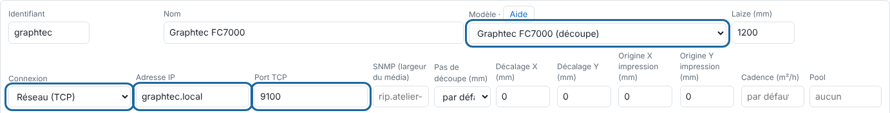

The RIP sends the cut to the Graphtec FC7000 in HP-GL, in 0.025 mm steps.

## Before you start

You need an administrator account. The machine is on the network with a fixed address, or connected by serial or USB-serial.

## Steps

1. On the Graphtec, set the commands to **HP-GL**: Menu > Interface > Command.
2. Set the **ARMS** registration at the machine's panel.
3. Reserve a fixed address for the machine.
4. In the client, open **Administration…**, the **System** view (*Système*), the **Machines** section, click **Add a machine** (*Ajouter une machine*) and choose the **Graphtec FC7000 (cutting)** model (*Graphtec FC7000 (découpe)*).
5. Under **Connection** (*Connexion*), choose **Network (TCP)** (*Réseau (TCP)*) (or **Serial / USB-serial**, *Série / USB-série*), and enter the address in **IP address** (*Adresse IP*) and the **TCP port** (*Port TCP*).

   
6. Check the **Cutting step (mm)** (*Pas de découpe (mm)*) (0.025 mm), the cut settings and the **X / Y offset** (*Décalage X / Y*), then click **Save** (*Enregistrer*).
7. Check from the server: `nc -vz <graphtec-address> <port>`.

## Good to know

- Nothing cuts: the machine's interface is not set to HP-GL.
- Failed output, machine unreachable: check the address, the port and the cable.
- If the cut is offset from the print, measure the gap on a test cut and enter the **X / Y offset**.

## See also

- [Add a machine to the RIP](rip-ajouter-une-machine.md)
- [Fix a cut that is offset from the print](../rip-depannage/rip-decoupe-decalee.md)
- [Choose a machine's connection](rip-choisir-la-connexion-d-une-machine.md)
