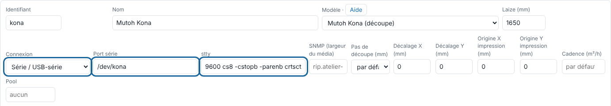

The RIP sends the cut to the Kona the way the manufacturer's software does (HP-GL, 0.01 mm step), with the frame and barcode read for registration.

## Before you start

You need an administrator account and a free USB port on the server. The RIP service already has permission to write to it.

## Steps

1. Connect the Kona over USB (FTDI serial adapter). The package creates `/dev/kona` for the `dialout` group.
2. Check the port: `ls -l /dev/kona`.
3. On the Kona, set the resolution to **0.010 mm**.
4. In the client, add the machine (**Administration… › System › Machines › Add a machine**; *Système › Machines › Ajouter une machine*) with the **Serial / USB-serial** connection (*Série / USB-série*), the **Serial port** (*Port série*) `/dev/kona` and the **stty** setting `9600 cs8 -cstopb -parenb crtscts raw -echo`.

   
5. Set the cutting step to 0.01 mm and the **cut settings** (speed, force, acceleration, tool, pattern); the first one is the default.
6. When you send a job, choose the **Kona registration** (*Repérage Kona*). The frame with barcode (type 2) is the one proven in the workshop.
7. Make a test cut, measure the gap and enter it as the **X / Y offset** (*Décalage X / Y*).

## Good to know

- Feed in the Kona the edge shown by the ▲ arrow on the frame.
- If the cut comes out rotated by 180°, tick **Flipped cut** (*Découpe retournée*).
- `/dev/kona` missing: unplug, plug back in, then check `journalctl -k | tail`.
- Stop on "EPOS 6213": a type 1 frame, with no barcode, was sent directly; the Kona cannot read it on its own. Use type 2.
- With a Kona registration, the cut lines and crosses are not printed (they would get in the way of reading): an alert says so.
- For a page of 1.5 m or more in the feed direction, type 2 automatically uses the multi-segment frame.

## See also

- [Fix a cut that is offset from the print](../rip-depannage/rip-decoupe-decalee.md)
- [Choose the Kona registration](rip-choisir-le-reperage-kona.md)
- [Set up the Kona cut](rip-regler-la-coupe-du-kona.md)
- [Add a machine to the RIP](rip-ajouter-une-machine.md)
