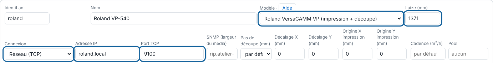

The Roland VersaCAMM is a print-and-cut machine. The RIP sends it the cut over the network (roll width 762 or 1371 mm). Printing on the Roland is not yet driven by the RIP.

## Before you start

You need an administrator account and the Roland connected to the server's network with a fixed address.

## Steps

1. Reserve a fixed address for the Roland on your router.
2. In the client, open **Administration…**, the **System** view (*Système*), the **Machines** section, and click **Add a machine** (*Ajouter une machine*).
3. Choose the **Roland VersaCAMM VP (print + cut)** model (*Roland VersaCAMM VP (impression + découpe)*) and the **Roll width (mm)** (*Laize (mm)*) (762 or 1371 mm).
4. Under **Connection** (*Connexion*), choose **Network (TCP)** (*Réseau (TCP)*), and enter the address in **IP address** (*Adresse IP*) and the machine's **TCP port** (*Port TCP*).

   
5. Click **Save** (*Enregistrer*), at the bottom of the **Machines** section.
6. Check from the server: `nc -vz <roland-address> <port>`.

## Good to know

- Roland support is recent: report any discrepancy with **Report a problem…** (*Signaler un problème…*) in the client.
- If the cut is offset from the print, set the machine's **X / Y offset** (*Décalage X / Y*).
- Failed output "machine unreachable": check the address, the port and the cable.

## See also

- [Add a machine to the RIP](rip-ajouter-une-machine.md)
- [Fix a cut that is offset from the print](../rip-depannage/rip-decoupe-decalee.md)
- [Choose a machine's connection](rip-choisir-la-connexion-d-une-machine.md)
